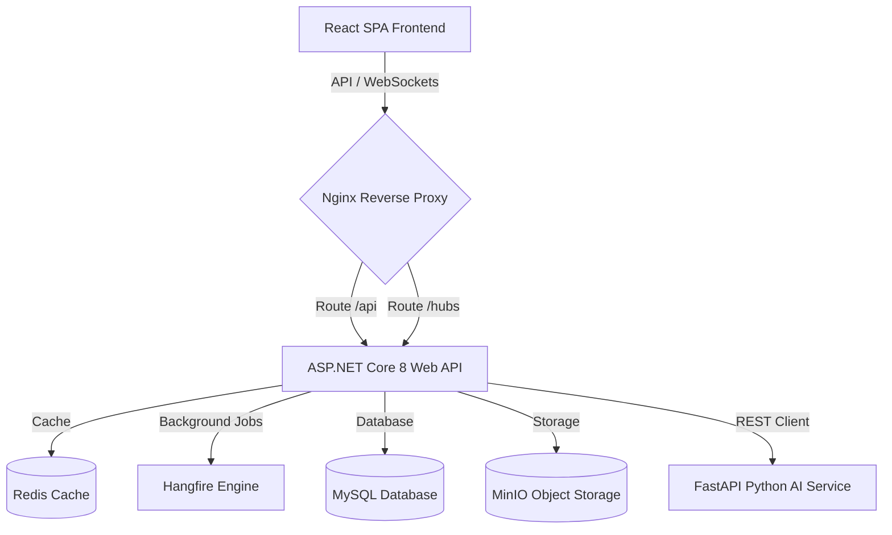
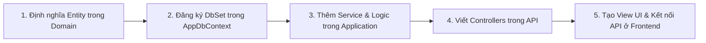

# FireGuard AI - Hệ Thống Quản Lý Thiết Bị Phòng Cháy Chữa Cháy Tích Hợp AI

FireGuard AI là hệ thống quản lý nguồn lực doanh nghiệp (ERP Mini) toàn diện, phục vụ cho các doanh nghiệp cung cấp, lắp đặt, bảo trì và sửa chữa thiết bị phòng cháy chữa cháy (PCCC) tích hợp trí tuệ nhân tạo (AI).

Hệ thống được thiết kế theo mô hình kiến trúc sạch (Clean Architecture) vững chắc, hiệu năng cao, bảo mật cao và sẵn sàng vận hành trong môi trường container hóa (Docker/Production).

---

## 📋 Mục Lục
1. [Tính Năng Nổi Bật](#-tính-năng-nổi-bật)
2. [Kiến Trúc & Công Nghệ](#-kiến-trúc--công-nghệ)
3. [Cấu Trúc Thư Mục](#-cấu-trúc-thư-mục)
4. [Yêu Cầu Môi Trường](#-yêu-cầu-môi-trường)
5. [Cấu Hình Môi Trường (.env)](#-cấu-hình-môi-trường-env)
6. [Hướng Dẫn Khởi Chạy Nhanh (Docker Compose)](#-hướng-dẫn-khởi-chạy-nhanh-docker-compose)
7. [Hướng Dẫn Chạy Thủ Công (Development)](#-hướng-dẫn-chạy-thủ-công-development)
8. [Quy Trình Migration & Seed Dữ Liệu](#-quy-trình-migration--seed-dữ-liệu)
9. [Danh Sách Tài Khoản Demo](#-danh-sách-tài-khoản-demo)
10. [Địa Chỉ Dịch Vụ Hệ Thống](#-địa-chỉ-dịch-vụ-hệ-thống)
11. [Hướng Dẫn Chạy Kiểm Thử (Tests)](#-hướng-dẫn-chạy-kiểm-thử-tests)
12. [Xử Lý Sự Cố Thường Gặp (Troubleshooting)](#-xử-lý-sự-cố-thường-gặp-troubleshooting)
13. [Quy Trình Git & Quy Tắc Commit](#-quy-trình-git--quy-tắc-commit)
14. [Quy Trình Phát Triển Module Mới](#-quy-trình-phát-triển-module-mới)
15. [Chính Sách Bảo Mật](#-chính-sách-bảo-mật)
16. [Lộ Trình Tính Năng Tương Lai](#-lộ-trình-tính-năng-tương-lai)

---

## ✨ Tính Năng Nổi Bật

*   **AI Báo Giá Sơ Bộ**: Ước lượng chi phí thiết bị, lắp đặt, khảo sát dựa trên diện tích, số tầng, loại công trình và ngân sách của khách hàng; hỗ trợ nhân viên duyệt báo giá nhanh.
*   **AI Diagnostics**: Chẩn đoán lỗi thiết bị PCCC (áp suất thấp, hỏng cảm biến) từ dữ liệu nhập vào và lịch sử bảo dưỡng; hướng dẫn kiểm tra an toàn cho kỹ thuật viên.
*   **AI Dispatching & Auto-routing**: Công thức chấm điểm có giải thích (Distance, Skill, Workload, Ratings, First-Time-Fix) tự động tìm kiếm và gán đơn sửa chữa cho kỹ thuật viên tối ưu.
*   **Daily Maintenance Scanner**: Hangfire job tự động quét các thiết bị sắp đến kỳ hạn bảo trì (quá hạn, 3 ngày, 7 ngày, 30 ngày) và tạo Service Request nháp.
*   **Monthly KPI Performance**: Đánh giá hiệu suất làm việc của thợ theo tháng với công thức trọng số đa chiều, cho phép Admin điều chỉnh điểm số kèm ghi chú kiểm toán.
*   **Google Maps Integration**: Theo dõi thời gian thực tọa độ địa lý của thợ đang làm việc, tính toán ETA, hiển thị sơ đồ định vị kỹ thuật viên gần nhất trên bản đồ Leaflet.
*   **Admin Dashboard**: Tổng hợp doanh thu, dự án trễ tiến độ, tồn kho thấp, và xếp hạng thợ xuất sắc sử dụng Redis Memory Cache tối ưu hóa thời gian phản hồi.
*   **Reports Export Center**: Tạo báo cáo doanh thu, kho hàng dạng Excel và PDF chạy bất đồng bộ qua Hangfire nền và đẩy link tải bảo mật thời hạn 24 giờ.
*   **Security Audit Logs**: Lưu lại toàn bộ lịch sử thao tác của các tài khoản (IP, User Agent, Correlation ID), tự động ẩn các dữ liệu nhạy cảm (passwords, tokens).

---

## 🏗️ Kiến Trúc & Công Nghệ

### Sơ Đồ Kiến Trúc Hệ Thống


### Công Nghệ Sử Dụng
- **Backend API**: ASP.NET Core 8.0, EF Core 8.0, Hangfire (Báo cáo & Reminders), SignalR (Thông báo thời gian thực).
- **Frontend SPA**: React 18, TypeScript, Vite, Material UI (MUI), Redux Toolkit, React Query.
- **AI Service**: Python FastAPI, OpenAI/Gemini SDKs.
- **Infrastructures**: MySQL 8.0, Redis 7 (Caching), MinIO (Lưu trữ tệp báo cáo xuất ra).

---

## 📂 Cấu Trúc Thư Mục

```text
fireguard-ai/
├── ai-service/              # Python FastAPI AI Service
│   ├── app/                 # Source code chính của AI
│   └── Dockerfile           # Dockerfile build AI Service
├── backend/                 # .NET Core Clean Architecture Web API
│   ├── src/
│   │   ├── FireGuard.Domain/         # Thực thể nghiệp vụ, Enums (Core Domain)
│   │   ├── FireGuard.Application/    # DTOs, Interfaces, Logic nghiệp vụ tổng quát
│   │   ├── FireGuard.Infrastructure/ # Database Context, Hangfire, Redis, MinIO adapters
│   │   └── FireGuard.API/            # Controllers, Middlewares, Program entry point
│   ├── tests/
│   │   └── FireGuard.Tests/          # Bộ kiểm thử xUnit và Integration Tests
│   └── Dockerfile           # Multi-stage Dockerfile chạy non-root cho backend
├── frontend/                # React Vite SPA Frontend
│   ├── src/                 # Components, Pages, State management, API hooks
│   ├── nginx.conf           # Cấu hình Reverse Proxy chạy Nginx Production
│   └── Dockerfile           # Multi-stage Dockerfile Nginx cho frontend
├── scripts/                 # Scripts tự động hóa quản trị hệ thống
│   ├── backup.sh            # Script sao lưu tự động MySQL & MinIO
│   └── restore.sh           # Script khôi phục dữ liệu từ bản sao lưu
├── docker-compose.dev.yml   # Docker Compose chạy môi trường phát triển (Local Dev)
├── docker-compose.prod.yml  # Docker Compose tối ưu hóa cấu hình cho Production
└── README.md                # Tài liệu hướng dẫn sử dụng (File này)
```

---

## 💻 Yêu Cầu Môi Trường

Đảm bảo máy tính phát triển hoặc máy chủ deploy đã cài đặt các công cụ sau:
- **Docker Desktop** hoặc **Docker Engine v24.0.0+**
- **Node.js v20.0.0+**
- **.NET 8.0 SDK** (chỉ yêu cầu nếu muốn chạy thủ công không qua Docker)

---

## 🔐 Cấu Hình Môi Trường (.env)

Tạo file `.env` tại thư mục gốc của dự án bằng cách sao chép file mẫu:
```bash
cp .env.example .env
```

Cập nhật các thông tin cấu hình bảo mật bắt buộc:
```ini
# --- DATABASE CONFIG ---
MYSQL_DATABASE=fireguard_db
MYSQL_ROOT_PASSWORD=ThayTheMatKhauRootChuaDay
MYSQL_USER=fireguard_user
MYSQL_PASSWORD=MatKhauNguoiDungPccc2026

# --- INFRASTRUCTURE PORTS ---
MYSQL_PORT=3306
REDIS_PORT=6379
MINIO_PORT=9000
MINIO_CONSOLE_PORT=9001
FASTAPI_PORT=8000

# --- SECURITY CONFIG ---
JWT_SECRET=super_secret_jwt_key_with_at_least_32_characters_123456
JWT_ACCESS_EXPIRY_MINUTES=15
JWT_REFRESH_EXPIRY_DAYS=7

# --- EXTERNAL INTEGRATIONS ---
OPENAI_API_KEY=your_openai_key_here
GEMINI_API_KEY=your_gemini_key_here
```

---

## 🚀 Hướng Dẫn Khởi Chạy Nhanh (Docker Compose)

### 1. Khởi chạy môi trường phát triển (Development)
Chạy lệnh sau tại thư mục gốc để dựng và chạy các service:
```bash
docker compose -f docker-compose.dev.yml up -d --build
```

### 2. Khởi chạy môi trường vận hành (Production)
Chạy lệnh sau để chạy container với giới hạn tài nguyên và cấu hình bảo mật:
```bash
docker compose -f docker-compose.prod.yml up -d --build
```
*Lưu ý: Môi trường Production sẽ tự động chạy Frontend trên cổng mặc định `80`, đóng tất cả các cổng debug cơ sở dữ liệu bên ngoài để đảm bảo an toàn.*

---

## 🔧 Hướng Dẫn Chạy Thủ Công (Development)

Nếu bạn muốn debug trực tiếp mã nguồn trên máy local không thông qua Docker:

### 1. Khởi động Cơ sở hạ tầng (Database & Cache)
Chạy các container nền trước:
```bash
docker compose -f docker-compose.dev.yml up -d mysql redis minio
```

### 2. Khởi chạy Backend API
```bash
cd backend
dotnet restore
dotnet run --project src/FireGuard.API
```
*Backend API chạy tại địa chỉ: `http://localhost:5000`*

### 3. Khởi chạy Frontend React
```bash
cd frontend
npm install
npm run dev
```
*Frontend chạy tại địa chỉ: `http://localhost:3000` (hoặc `http://localhost:5173`)*

---

## 🔄 Quy Trình Migration & Seed Dữ Liệu

### 1. Tạo và Cập Nhật Migrations
Khi thay đổi Model trong Domain, chạy các lệnh sau tại thư mục `backend` để cập nhật cơ sở dữ liệu:
```bash
# Tạo bản migration mới
dotnet ef migrations add <TenMigration> --project src/FireGuard.Infrastructure --startup-project src/FireGuard.API

# Cập nhật thay đổi vào Database MySQL
dotnet ef database update --project src/FireGuard.Infrastructure --startup-project src/FireGuard.API
```

### 2. Tự Động Seed Dữ Liệu Demo
Khi khởi động Backend, hệ thống tự động kiểm tra sự tồn tại của dữ liệu. Nếu database trống, seeder sẽ tự động chạy tạo dữ liệu mẫu bao gồm:
*   Đầy đủ tài khoản demo cho tất cả các vai trò.
*   30 Model thiết bị, 3 Kho chứa hàng, 100 Thiết bị được gán mã Serial & QR Code hoàn chỉnh.
*   Các bản ghi lịch sử KPI, Báo cáo kiểm toán mẫu, Báo giá và Yêu cầu sửa chữa.

---

## 🔑 Danh Sách Tài Khoản Demo

Mật khẩu chung cho tất cả các tài khoản demo là: **`FireGuard@2026`** (hoặc giá trị trong cấu hình `DEMO_PASSWORD`).

| Vai Trò | Username | Email | Phạm Vi Nghiệp Vụ |
| :--- | :--- | :--- | :--- |
| **System Admin** | `admin` | `admin@fireguard.vn` | Xem dashboard tổng thể, cấu hình KPI, duyệt báo giá chính thức, dọn dẹp nhật ký hệ thống. |
| **Nhân Viên Kinh Doanh** | `sales1` | `sales1@fireguard.vn` | Tạo báo giá sơ bộ AI, quản lý khách hàng, hợp đồng. |
| **Đội Trưởng Lắp Đặt** | `leader1` | `leader1@fireguard.vn` | Quản lý tiến độ công trình, phân bổ nhân sự. |
| **Thợ Lắp Đặt** | `member1` | `member1@fireguard.vn` | Check-in/out địa điểm thi công, cập nhật trạng thái lắp đặt. |
| **Kỹ Thuật Viên** | `tech1` | `tech1@fireguard.vn` | Chẩn đoán lỗi thiết bị, cập nhật GPS, nhận đơn điều phối sửa chữa. |
| **Khách Hàng (Customer)** | `customer1` | `customer1@client.com` | Xác nhận nhắc lịch bảo trì thiết bị sắp quá hạn. |

---

## 🌐 Địa Chỉ Dịch Vụ Hệ Thống

Sau khi chạy thành công, bạn có thể truy cập các đường dẫn sau:
- **Ứng dụng Frontend (React Client)**: `http://localhost:3000` (Production) hoặc `http://localhost:5173` (Development)
- **Tài liệu Swagger API (Backend)**: `http://localhost:5000/swagger` (Chỉ khả dụng ở Dev mode)
- **MinIO Storage Console (Quản lý file)**: `http://localhost:9001` (User: `minioadmin` | Pass: `minioadminpassword`)
- **Trang quản trị Hangfire (Bảng điều khiển Job)**: `http://localhost:5000/hangfire`

---

## 🧪 Hướng Dẫn Chạy Kiểm Thử (Tests)

### 1. Chạy tất cả các kiểm thử xUnit backend
```bash
cd backend
dotnet test
```

### 2. Xuất báo cáo Code Coverage dạng HTML
```bash
# Xuất file kết quả cobertura
dotnet test /p:CollectCoverage=true /p:CoverletOutputFormat=cobertura

# Tạo giao diện HTML báo cáo (Cần cài đặt reportgenerator)
reportgenerator -reports:"tests/FireGuard.Tests/coverage.cobertura.xml" -targetdir:"tests/FireGuard.Tests/coverage-report" -reporttypes:Html
```
*Mở file `tests/FireGuard.Tests/coverage-report/index.html` trên trình duyệt để kiểm tra tỷ lệ phủ của các dòng code.*

---

## 🛠️ Xử Lý Sự Cố Thường Gặp (Troubleshooting)

#### 1. Lỗi xung đột cổng (Port Collision)
*   **Triệu chứng**: Thông báo lỗi `port is already allocated` khi chạy docker-compose.
*   **Giải quyết**: Sửa lại giá trị cổng `MYSQL_PORT`, `REDIS_PORT` hoặc `MINIO_PORT` tương ứng trong file `.env` sang cổng khác rảnh trên máy.

#### 2. Lỗi CORS khi gọi API từ Frontend
*   **Triệu chứng**: Trình duyệt báo lỗi block CORS request khi frontend gọi backend.
*   **Giải quyết**: Đảm bảo các địa chỉ nguồn phát triển (ví dụ: `http://localhost:3000`, `http://localhost:5173`) đã được khai báo chính xác trong danh sách tin cậy của phương thức `AddCors` tại `Program.cs`.

#### 3. Lỗi DB Connection Timeout lúc khởi động
*   **Triệu chứng**: Backend container bị crash vì không thể kết nối tới MySQL.
*   **Giải quyết**: Kiểm tra xem container `fireguard_mysql` đã hoàn tất quá trình khởi tạo (healthy) hay chưa. docker-compose.prod đã cấu hình thuộc tính `depends_on: { condition: service_healthy }` để kiểm soát vấn đề này.

---

## 🌿 Quy Trình Git & Quy Tắc Commit

### 1. Quy Trình Nhánh (Git Branching Flow)
Hệ thống sử dụng Git Flow cơ bản:
*   `main`: Nhánh chứa mã nguồn production ổn định nhất.
*   `develop`: Nhánh tích hợp các tính năng đang phát triển.
*   `feature/<ten-tính-năng>`: Nhánh phát triển tính năng mới (tách ra từ `develop`).
*   `bugfix/<ten-lỗi>`: Nhánh sửa lỗi phát hiện được.

### 2. Quy Tắc Ghi Nhãn Commit (Semantic Commit Messages)
Mỗi commit message phải tuân thủ định dạng sau để thuận tiện cho việc kiểm soát:
```text
<type>(<scope>): <short description>
```
*Các loại thẻ (types) được chấp nhận*:
- `feat`: Thêm tính năng mới (ví dụ: `feat(dispatch): tích hợp công thức điểm mới`).
- `fix`: Sửa lỗi (ví dụ: `fix(auth): sửa lỗi hết hạn refresh token`).
- `docs`: Cập nhật tài liệu (ví dụ: `docs(readme): bổ sung quy trình tạo module`).
- `style`: Định dạng code (whitespace, format, missing semi-colons).
- `refactor`: Tái cấu trúc lại code mà không thay đổi tính năng hay sửa lỗi.
- `test`: Thêm hoặc cập nhật các bài test unit.

---

## 🏗️ Quy Trình Phát Triển Module Mới

Khi một lập trình viên mới muốn thêm một phân hệ (module) mới vào dự án, hãy thực hiện theo 5 bước tiêu chuẩn sau:



### Bước 1: Định nghĩa thực thể (Entity) trong tầng Domain
Tạo thực thể mới kế thừa từ `AuditableEntity<string>` hoặc `BaseEntity<string>` trong thư mục `backend/src/FireGuard.Domain/Entities/`.
```csharp
namespace FireGuard.Domain.Entities.Sales
{
    public class CustomerDiscount : AuditableEntity<string>
    {
        public CustomerDiscount() { Id = Guid.NewGuid().ToString(); }
        public string CustomerId { get; set; } = null!;
        public decimal DiscountPercentage { get; set; }
    }
}
```

### Bước 2: Đăng ký Dbset và cấu hình bảng trong Infrastructure
1. Mở [ApplicationDbContext.cs](file:///c:/Users/Mr%20VU/Desktop/Ung%20dung%20PCCC/fireguard-ai/backend/src/FireGuard.Infrastructure/Persistence/ApplicationDbContext.cs) và thêm thuộc tính `DbSet<CustomerDiscount>`.
2. Tạo file cấu hình mapping (ví dụ: `CustomerDiscountConfiguration.cs`) trong thư mục `Infrastructure/Persistence/Configurations/` để thiết lập khóa ngoại, ràng buộc dữ liệu.

### Bước 3: Tạo Service Interface & Implement
1. Tạo interface (ví dụ: `ICustomerDiscountService`) tại thư mục `Application/Common/Interfaces/`.
2. Viết class implement cụ thể trong thư mục `Infrastructure/Services/`.
3. Đăng ký Service vào Container IoC tại [DependencyInjection.cs](file:///c:/Users/Mr%20VU/Desktop/Ung%20dung%20PCCC/fireguard-ai/backend/src/FireGuard.Infrastructure/DependencyInjection.cs).

### Bước 4: Tạo REST Controller
Tạo controller mới kế thừa từ `ControllerBase` trong thư mục `backend/src/FireGuard.API/Controllers/`. Sử dụng các decorator `[Authorize]` và `[HasPermission("...")]` để phân quyền bảo mật chặt chẽ.

### Bước 5: Cập nhật giao diện Frontend
1. Tạo component React/MUI tương ứng tại thư mục `frontend/src/pages/`.
2. Đăng ký Route mới trong [App.tsx](file:///c:/Users/Mr%20VU/Desktop/Ung%20dung%20PCCC/fireguard-ai/frontend/src/App.tsx).
3. Cập nhật menu liên kết tại [Sidebar.tsx](file:///c:/Users/Mr%20VU/Desktop/Ung%20dung%20PCCC/fireguard-ai/frontend/src/components/Sidebar.tsx).

---

## 🔒 Chính Sách Bảo Mật

*   **Nguyên Tắc Đặc Quyền Tối Thiểu (Least Privilege)**: Tuyệt đối không sử dụng tài khoản `admin` cho các thao tác nghiệp vụ thông thường. Chỉ cấp phát phân quyền chính xác tương ứng với đầu công việc của từng nhân sự.
*   **Mã Hóa Dữ Liệu**: Mọi tệp tin báo cáo được sinh ra tạm thời trong thư mục `exports` sẽ được mã hóa và xóa định kỳ. Liên kết tải xuống chỉ có hiệu lực duy nhất trong 24 giờ.
*   **Ẩn Thông Tin Nhạy Cảm**: Tuyệt đối không ghi đè, in log mật khẩu, token JWT hay Access Key của bên thứ 3 ra Console hoặc Database Audit. Hãy sử dụng cơ chế đệ quy lọc của `AuditService` để đảm bảo an toàn.

---

## 🚀 Các Tính Năng Tương Lai

1.  **AI Camera Phân Tích**: Tích hợp camera giám sát tại nhà kho để tự động nhận diện thiết bị PCCC bị đặt sai vị trí hoặc bị chặn lỗi thoát hiểm.
2.  **Tích Hợp Hóa Đơn Điện Tử (e-Invoice)**: Tự động phát hành hóa đơn đỏ khi báo giá được khách hàng ký số phê duyệt hợp đồng chính thức.
3.  **Trợ lý ảo Voice-to-Text**: Giúp kỹ thuật viên công trường điền biên bản khảo sát bằng giọng nói thông qua ứng dụng di động thay vì nhập liệu tay.
