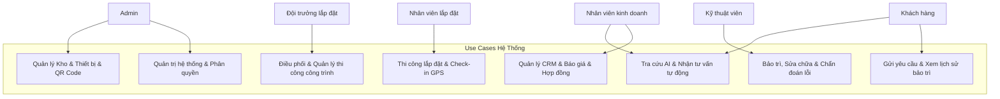
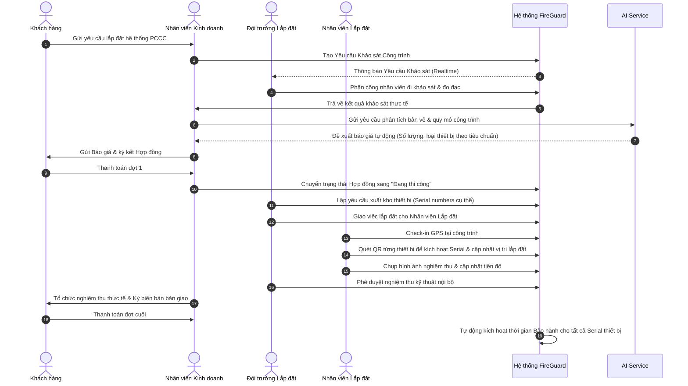
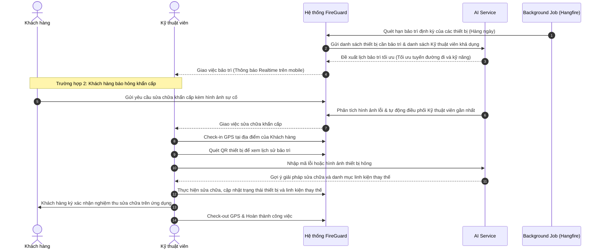
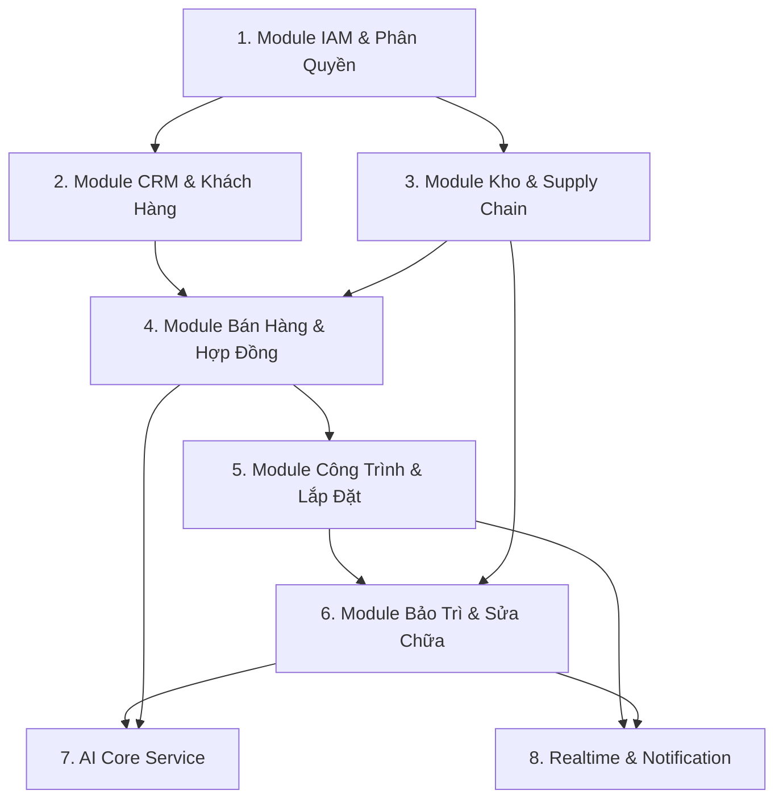
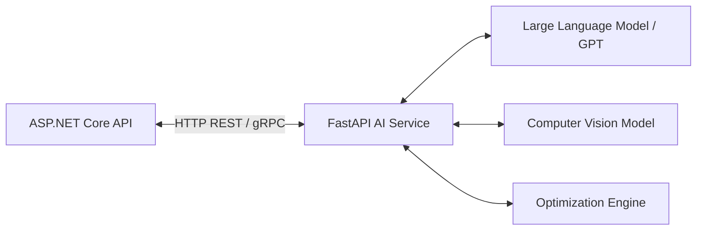

# FireGuard AI - Phân Tích Nghiệp Vụ Chi Tiết (Business Analysis)

> [!NOTE]
> Tài liệu này được biên soạn bởi Senior Software Architect nhằm mục đích làm nền tảng nghiệp vụ cho hệ thống FireGuard AI - Hệ thống ERP Mini quản lý cung cấp, lắp đặt, bảo trì và sửa chữa thiết bị phòng cháy chữa cháy (PCCC) tích hợp AI.

---

## 1. Danh Sách Actor (Actor List)

Hệ thống **FireGuard AI** phục vụ 6 nhóm đối tượng sử dụng chính với các quyền hạn và vai trò khác nhau:

| STT | Actor | Mô Tả Vai Trò |
| :--- | :--- | :--- |
| 1 | **Admin** | Quản trị viên hệ thống. Quản lý tài khoản, phân quyền, cấu hình hệ thống, xem audit log, giám sát dashboard tổng quan và can thiệp cấu hình AI. |
| 2 | **Nhân viên kinh doanh** *(Sales Rep)* | Quản lý thông tin khách hàng, nhà cung cấp. Tạo yêu cầu khảo sát, lập báo giá, soạn thảo hợp đồng, theo dõi doanh thu và công nợ bán hàng. |
| 3 | **Đội trưởng lắp đặt** *(Installation Lead)* | Quản lý đội thi công, tiếp nhận dự án lắp đặt, phân công nhân viên lắp đặt, cập nhật tiến độ công trình, kiểm tra kết quả nghiệm thu và báo cáo sự cố. |
| 4 | **Nhân viên lắp đặt** *(Installation Staff)* | Thực hiện việc thi công lắp đặt tại công trình. Check-in/check-out bằng GPS, chụp ảnh hiện trường báo cáo tiến độ, kích hoạt serial thiết bị qua mã QR Code. |
| 5 | **Kỹ thuật viên** *(Technician)* | Tiếp nhận các yêu cầu bảo trì định kỳ, sửa chữa khẩn cấp. Check-in/check-out GPS, kiểm tra thiết bị, quét QR để truy xuất lịch sử, chẩn đoán sự cố (với sự hỗ trợ của AI) và báo cáo kết quả. |
| 6 | **Khách hàng** *(Customer)* | Chủ đầu tư, quản lý tòa nhà hoặc hộ gia đình. Theo dõi tiến độ công trình, xem lịch sử bảo hành/bảo trì, gửi yêu cầu sửa chữa khẩn cấp, tương tác với AI tư vấn và nhận báo cáo nghiệm thu kỹ thuật số. |

---

## 2. Use Case Của Từng Actor

### 2.1. Admin
*   Quản lý danh sách người dùng, phân vai trò (Role) và các quyền chi tiết (Permission).
*   Giám sát Audit Logs (ghi lại toàn bộ hành động tạo, sửa, xóa dữ liệu nhạy cảm).
*   Quản lý danh mục chung hệ thống (loại thiết bị PCCC, tiêu chuẩn PCCC Việt Nam).
*   Xem Dashboard phân tích doanh thu, hiệu suất làm việc (KPI) của nhân viên và đánh giá độ chính xác của các mô hình AI.
*   Quản lý lưu trữ tệp (MinIO), cấu hình Cache (Redis) và các Background Jobs (Hangfire).

### 2.2. Nhân Viên Kinh Doanh
*   Quản lý hồ sơ Khách hàng và Nhà cung cấp.
*   Tạo Yêu cầu khảo sát công trình thực tế gửi cho Đội trưởng lắp đặt.
*   Tạo Báo giá: Nhập tay hoặc sử dụng **AI báo giá** (phân tích bản vẽ hoặc mô tả quy mô để tự động đề xuất số lượng bình chữa cháy, đầu báo khói, hệ thống đường ống theo tiêu chuẩn).
*   Tạo và quản lý Hợp đồng bán hàng/lắp đặt/bảo trì.
*   Theo dõi tiến độ thanh toán của khách hàng.

### 2.3. Đội Trưởng Lắp Đặt
*   Tiếp nhận các Yêu cầu khảo sát từ bộ phận kinh doanh và phân công người thực hiện.
*   Quản lý đội thi công (phân chia nhân lực vào các nhóm lắp đặt cụ thể).
*   Lập kế hoạch thi công, phân bổ thiết bị/vật tư từ Kho vào dự án.
*   Giám sát tiến độ lắp đặt, duyệt báo cáo nghiệm thu nội bộ của nhân viên.
*   Báo cáo thiếu hụt vật tư hoặc các sự cố phát sinh tại công trình.

### 2.4. Nhân Viên Lắp Đặt
*   Nhận phân công ca làm việc và danh sách thiết bị cần lắp đặt tại công trình.
*   Thực hiện check-in (qua định vị GPS) khi đến công trình và check-out khi hoàn thành ca làm.
*   Quét mã QR trên thiết bị để kích hoạt trạng thái "Đã lắp đặt", liên kết Serial Number của thiết bị với vị trí cụ thể trên bản đồ mặt bằng.
*   Tải hình ảnh thực tế thi công lên hệ thống để lưu trữ audit/nghiệm thu (lưu vào MinIO).

### 2.5. Kỹ Thuật Viên (Technician)
*   Nhận lịch bảo trì định kỳ hoặc yêu cầu sửa chữa khẩn cấp (được **AI điều phối** dựa trên khoảng cách GPS và chuyên môn kỹ thuật).
*   Check-in GPS tại địa điểm khách hàng để xác nhận thời gian có mặt.
*   Quét mã QR trên thiết bị để truy xuất toàn bộ vòng đời thiết bị (ngày lắp đặt, lịch sử bảo trì, các lỗi từng gặp).
*   Sử dụng **AI chẩn đoán** lỗi (nhập triệu chứng hoặc chụp ảnh thiết bị lỗi để AI gợi ý nguyên nhân và cách khắc phục theo catalog).
*   Ghi nhận kết quả xử lý, chụp ảnh xác nhận hoàn thành, xin chữ ký số xác nhận của khách hàng.

### 2.6. Khách Hàng
*   Gửi yêu cầu khảo sát, yêu cầu bảo trì hoặc báo cáo sự cố hỏng hóc khẩn cấp.
*   Theo dõi tiến độ thi công công trình theo thời gian thực (realtime progress).
*   Quét QR Code trên các thiết bị đã bàn giao để tự tra cứu thời hạn bảo hành, hướng dẫn sử dụng khẩn cấp khi có hỏa hoạn.
*   Tương tác với **AI tư vấn** (Chatbot giải đáp luật PCCC, tư vấn cách xử lý khi gặp sự cố ban đầu).

---

## 3. Luồng Nghiệp Vụ Chính (Main Workflows)

### 3.1. Luồng Bán Hàng - Lắp Đặt Công Trình

### 3.2. Luồng Bảo Trì Định Kỳ & Sửa Chữa Khẩn Cấp

---

## 4. Trạng Thái Của Các Đối Tượng Nghiệp Vụ (Entity Statuses)

Để quản lý chính xác luồng công việc, các thực thể chính trong hệ thống sẽ tuân theo các trạng thái nghiêm ngặt:

### 4.1. Trạng thái Yêu Cầu Khảo Sát (Survey Request Status)
*   `Draft` (Bản nháp - Kinh doanh đang soạn thảo)
*   `PendingAssignment` (Chờ phân công đội khảo sát)
*   `Assigned` (Đã phân công nhân sự khảo sát)
*   `InProgress` (Đang tiến hành khảo sát tại thực địa)
*   `Completed` (Đã hoàn thành khảo sát, có báo cáo chi tiết)
*   `Cancelled` (Hủy yêu cầu)

### 4.2. Trạng thái Báo Giá (Quotation Status)
*   `Draft` (Bản nháp)
*   `Sent` (Đã gửi khách hàng)
*   `Approved` (Khách hàng đồng ý báo giá)
*   `Rejected` (Khách hàng từ chối báo giá)
*   `Expired` (Hết hạn hiệu lực báo giá)

### 4.3. Trạng thái Hợp Đồng (Contract Status)
*   `Draft` (Bản nháp)
*   `PendingSignature` (Chờ ký kết)
*   `Active` (Hợp đồng có hiệu lực - Đang thực hiện)
*   `Suspended` (Tạm ngưng do vi phạm điều khoản/chậm thanh toán)
*   `Terminated` (Chấm dứt trước hạn)
*   `Completed` (Đã nghiệm thu thanh lý hợp đồng)

### 4.4. Trạng thái Công Trình / Công Việc Thi Công (Project / Task Status)
*   `Planning` (Đang lập kế hoạch thi công)
*   `ReadyToStart` (Đã chuẩn bị xong vật tư, sẵn sàng thi công)
*   `InExecution` (Đang tiến hành thi công lắp đặt)
*   `Testing` (Đang kiểm thử, nghiệm thu nội bộ)
*   `Accepted` (Đã bàn giao, nghiệm thu với khách hàng thành công)
*   `Delayed` (Bị chậm trễ tiến độ)

### 4.5. Trạng thái Thiết Bị Theo Serial (Device Serial Status)
*   `InStock` (Đang lưu trong kho của công ty)
*   `Allocated` (Đã xuất kho gán cho công trình, đang vận chuyển)
*   `Installed` (Đã lắp đặt thành công tại vị trí công trình)
*   `Active` (Đang hoạt động bình thường)
*   `UnderMaintenance` (Đang trong quá trình bảo trì/kiểm tra)
*   `Faulty` (Đang bị lỗi/hỏng hóc chờ sửa chữa)
*   `Scrapped` (Đã thanh lý/hủy bỏ)

---

## 5. Quy Tắc Nghiệp Vụ (Business Rules)

### 5.1. Quản Lý Thiết Bị Và Serial Number
*   Mỗi thiết bị PCCC (như bình chữa cháy, đầu báo khói, van chặn) khi nhập kho **phải** được gán một mã Serial Number duy nhất và một mã QR Code định danh tương ứng. Không quản lý chung chung theo số lượng đơn thuần cho các thiết bị cần bảo dưỡng định kỳ.
*   Thông tin QR Code chứa: URL định danh của thiết bị, mã Serial, tên thiết bị, ngày sản xuất, hạn sử dụng chất chữa cháy (đối với bình CO2/bột), trạng thái bảo hành.

### 5.2. Lắp Đặt Và GPS Check-in
*   Nhân viên lắp đặt/Kỹ thuật viên chỉ có thể thực hiện thao tác **Check-in** trên ứng dụng nếu tọa độ GPS của thiết bị di động trùng khớp với tọa độ công trình/địa chỉ khách hàng trong phạm vi bán kính cho phép (ví dụ: tối đa 100 mét).
*   Không được phép cập nhật trạng thái "Đã nghiệm thu lắp đặt" nếu chưa có hình ảnh đính kèm minh chứng thực tế (lưu trữ trên MinIO) và tọa độ check-in hợp lệ.

### 5.3. Tiêu Chuẩn Bảo Trì PCCC
*   Hệ thống tự động áp dụng các quy chuẩn PCCC (TCVN 3890:2023) để đưa ra chu kỳ bảo trì bắt buộc cho từng loại thiết bị.
    *   *Bình chữa cháy*: Phải kiểm tra định kỳ tối thiểu 1 lần/tháng và bảo dưỡng nạp sạc lại mỗi 6 tháng hoặc 12 tháng tùy loại bình.
    *   *Hệ thống báo cháy tự động*: Phải bảo dưỡng định kỳ ít nhất 2 lần/năm.
*   Nếu quá hạn bảo trì quá 7 ngày mà chưa có kỹ thuật viên đến check-in thực hiện, hệ thống sẽ tự động gửi cảnh báo khẩn cấp (escalate) lên Đội trưởng và Admin.

### 5.4. Quy Tắc Xuất Kho Dữ Liệu
*   Để tránh thất thoát thiết bị, việc xuất kho thiết bị phục vụ lắp đặt bắt buộc phải đối chiếu khớp với mã Hợp đồng hoặc mã Công trình đã được phê duyệt. Tránh việc nhân viên tự ý rút thiết bị ra khỏi kho mà không có lý do dự án rõ ràng.

---

## 6. Các Trường Hợp Ngoại Lệ (Exceptions & Edge Cases)

*   **Ngoại lệ 1: Mất kết nối mạng tại công trình (Offline Mode)**
    *   *Mô tả*: Công trình PCCC thường nằm ở tầng hầm, phòng kín không có sóng 3G/4G/Wifi. Nhân viên không thể check-in hoặc quét QR gửi dữ liệu trực tiếp về server.
    *   *Xử lý*: Ứng dụng Frontend di động phải hỗ trợ lưu trữ tạm thời (Local DB/IndexDB). Khi quét QR và chụp ảnh ngoại tuyến, hệ thống sẽ mã hóa và lưu trữ tại chỗ kèm timestamp và tọa độ GPS offline từ thiết bị. Khi có mạng trở lại, ứng dụng sẽ đồng bộ hóa tự động lên Server.
*   **Ngoại lệ 2: Phát hiện Serial thiết bị bị trùng lặp hoặc QR Code bị rách/hỏng**
    *   *Mô tả*: Nhân viên quét QR Code tại hiện trường nhưng hệ thống báo lỗi không tồn tại hoặc báo trùng với thiết bị của công trình khác.
    *   *Xử lý*: Cho phép nhân viên nhập mã Serial thủ công (nếu còn nhìn rõ số khắc trên vỏ thiết bị) hoặc yêu cầu gửi phiếu yêu cầu cấp lại mã QR mới từ Admin. Trạng thái thiết bị tạm thời chuyển thành `UnderReview`.
*   **Ngoại lệ 3: Sai lệch tồn kho thực tế (Stock Discrepancy)**
    *   *Mô tả*: Khi xuất kho thi công, thủ kho phát hiện số lượng bình chữa cháy thực tế ít hơn số lượng ghi trên phần mềm do hư hỏng hoặc thất thoát chưa ghi nhận.
    *   *Xử lý*: Hệ thống cho phép ghi nhận biên bản "Lệch kho", khóa số lượng bị thiếu và gửi cảnh báo khẩn cấp tới Ban giám đốc để điều phối nguồn hàng thay thế từ kho khác hoặc nhà cung cấp khác để kịp tiến độ công trình.

---

## 7. Danh Sách Module & Mối Quan Hệ Giữa Các Module

### 7.1. Module IAM (Identity & Access Management)
*   Quản lý danh sách nhân viên, tài khoản khách hàng.
*   Cấp phát JWT token (Access Token ngắn hạn, Refresh Token dài hạn lưu DB).
*   Kiểm soát phân quyền dựa trên Role (Admin, Sales, Lead, Staff, Tech, Customer) và Permissions tương ứng.

### 7.2. Module CRM (Customer & Supplier Relationship Management)
*   Quản lý hồ sơ Khách hàng (Cá nhân/Doanh nghiệp, địa điểm công trình, thông tin người liên hệ).
*   Quản lý Nhà cung cấp thiết bị PCCC (đại lý phân phối đầu báo khói, bình chữa cháy nhập khẩu...).

### 7.3. Module Kho & Chuỗi Cung Ứng (Inventory & Supply Chain)
*   Quản lý Danh mục thiết bị (chủng loại, thông số kỹ thuật, hạn sử dụng chất chữa cháy).
*   Quản lý Nhập kho (nhập từ nhà cung cấp, sinh mã QR Code cho từng serial thiết bị).
*   Quản lý Xuất kho (xuất đi lắp đặt dự án, xuất linh kiện thay thế sửa chữa).
*   Kiểm kê kho vật lý.

### 7.4. Module Bán Hàng & Hợp Đồng (Sales & Contracts)
*   Quản lý thông tin Báo giá (Quotation).
*   Quản lý Hợp đồng lắp đặt và hợp đồng dịch vụ bảo trì định kỳ dài hạn.
*   Quản lý Hóa đơn tài chính và lịch trình thanh toán.

### 7.5. Module Công Trình & Lắp Đặt (Project & Installation)
*   Quản lý kế hoạch thi công công trình PCCC.
*   Phân chia công việc lắp đặt và quản lý tiến độ từng hạng mục.
*   Lưu trữ biên bản nghiệm thu kỹ thuật kèm hình ảnh thi công thực tế.

### 7.6. Module Bảo Trì, Sửa Chữa & Bảo Hành (Service & Maintenance)
*   Quản lý thông tin bảo hành của từng Serial thiết bị đã kích hoạt.
*   Quản lý lịch trình và kế hoạch bảo trì định kỳ.
*   Tiếp nhận phiếu yêu cầu sửa chữa sự cố khẩn cấp (Helpdesk ticket).
*   Ghi nhận nhật ký xử lý lỗi của kỹ thuật viên.

### 7.7. Module AI Core Service (FastAPI)
*   Cung cấp các API phân tích thông minh phục vụ cho các phân hệ bán hàng, lập lịch và chẩn đoán lỗi kỹ thuật.

### 7.8. Module Realtime & Notification (SignalR)
*   Đẩy thông báo tức thời (Push Notification) đến ứng dụng di động của kỹ thuật viên khi được giao việc mới.
*   Đồng bộ trạng thái cập nhật tiến độ công trình lên màn hình giám sát của Đội trưởng và Khách hàng theo thời gian thực.

---

## 8. Những Phần Cần Xử Lý Realtime (SignalR)

Để đảm bảo hiệu quả vận hành của một hệ thống ERP Mini điều phối thực địa, các tính năng sau đây bắt buộc phải xử lý realtime:
1.  **Thông báo giao việc khẩn cấp (Emergency Dispatching)**: Khi khách hàng gửi yêu cầu sửa chữa khẩn cấp (như chuông báo cháy giải kêu liên tục, rò rỉ khí gas chữa cháy), hệ thống điều phối kỹ thuật viên và gửi thông báo đẩy ngay lập tức tới thiết bị di động của kỹ thuật viên được chọn.
2.  **Giám sát tiến độ công trình (Live Construction Progress)**: Khi nhân viên lắp đặt quét mã QR và xác nhận lắp đặt thành công một thiết bị, giao diện Dashboard của Đội trưởng lắp đặt và màn hình theo dõi của Khách hàng sẽ tự động cập nhật tiến độ phần trăm (%) hoàn thành mà không cần tải lại trang.
3.  **Bản đồ vị trí kỹ thuật viên (Live Technician Tracking)**: Đội trưởng có thể nhìn thấy tọa độ di chuyển thực tế của các kỹ thuật viên trên bản đồ số khi họ đang trên đường thực hiện ca sửa chữa.
4.  **Cảnh báo an toàn hệ thống (Safety Alerts)**: Phát hiện các bình chữa cháy bị bỏ quên quá hạn bảo trì hoặc các công trình đang bị chậm tiến độ nghiêm trọng so với cam kết hợp đồng.

---

## 9. Những Phần Cần Background Job (Hangfire)

Các tác vụ tốn thời gian hoặc cần chạy định kỳ tự động sẽ được xử lý ngầm để tránh gây nghẽn luồng API chính:
1.  **Quét hạn bảo dưỡng thiết bị hàng ngày (Daily Maintenance Check)**: Mỗi đêm, một background job sẽ quét toàn bộ bảng dữ liệu thiết bị đang hoạt động để tìm các thiết bị sắp đến hạn bảo trì trong vòng 15 ngày tới, tự động gom nhóm theo vị trí khách hàng để gửi yêu cầu cho AI sắp xếp lịch.
2.  **Gửi email thông báo tự động (Automatic Email Notifications)**: Gửi báo giá cho khách hàng, gửi email nhắc thanh toán đợt hợp đồng tiếp theo, gửi biên bản nghiệm thu định dạng PDF sau khi được phê duyệt.
3.  **Tự động cập nhật hết hạn bảo hành (Warranty Expiry Updater)**: Kiểm tra và chuyển trạng thái bảo hành của các thiết bị sang "Hết hạn" khi đến ngày quy định.
4.  **Đồng bộ dữ liệu định kỳ (Data Synchronization)**: Đồng bộ các log hoạt động (Audit Logs) sang kho lưu trữ lưu trữ dài hạn hoặc thực hiện tối ưu hóa chỉ mục tìm kiếm (search index).

---

## 10. Chiến Lược Tích Hợp AI (AI Integration Scope)

Hệ thống tích hợp AI thông qua một service Python FastAPI độc lập để đảm bảo hiệu năng tính toán và dễ dàng tích hợp các thư viện Machine Learning phổ biến.

### 10.1. AI Tư Vấn PCCC & Luật
*   *Công nghệ*: RAG (Retrieval-Augmented Generation) kết hợp Large Language Model (LLM).
*   *Ứng dụng*: Khách hàng và nhân viên có thể đặt câu hỏi về luật PCCC Việt Nam (như TCVN 3890, Nghị định 136). AI truy xuất cơ sở dữ liệu luật pháp được cấu trúc sẵn để đưa ra câu trả lời chính xác, kèm điều khoản dẫn chiếu cụ thể.

### 10.2. AI Hỗ Trợ Báo Giá & Đọc Bản Vẽ (AI Quote & Design)
*   *Công nghệ*: Computer Vision (Object Detection) kết hợp LLM.
*   *Ứng dụng*: Nhân viên kinh doanh tải lên bản vẽ mặt bằng CAD/PDF của công trình. AI quét sơ đồ mặt bằng, nhận diện diện tích, các phòng chức năng, từ đó tự động tính toán số lượng bình chữa cháy, đầu báo khói, đèn exit thoát nạn tối thiểu cần thiết để đáp ứng đúng quy chuẩn PCCC, đề xuất danh mục vật tư cho báo giá.

### 10.3. AI Chẩn Đoán Lỗi Thiết Bị (AI Diagnostics)
*   *Công nghệ*: Image Classification & LLM.
*   *Ứng dụng*: Khi kỹ thuật viên gặp một lỗi lạ trên tủ trung tâm báo cháy hoặc các đầu báo địa chỉ, họ chụp ảnh màn hình hiển thị lỗi hoặc nhập các mã lỗi hiển thị. AI đối chiếu với thư viện catalog và cẩm nang hướng dẫn sửa chữa của nhà sản xuất để chỉ ra nguyên nhân (ví dụ: đứt cáp loop, lỗi nguồn dự phòng) và đưa ra các bước sửa chữa khuyến nghị.

### 10.4. AI Điều Phối & Tối Ưu Lộ Trình (AI Scheduling & Dispatch)
*   *Công nghệ*: Thuật toán tối ưu hóa định tuyến (Vehicle Routing Problem - VRP) kết hợp heuristic.
*   *Ứng dụng*: Tự động phân bổ hàng chục lịch bảo trì trong ngày cho các kỹ thuật viên sao cho tổng quãng đường di chuyển của toàn đội là ngắn nhất, đồng thời đảm bảo kỹ thuật viên được giao việc có đủ chứng chỉ kỹ thuật phù hợp với yêu cầu của công trình đó (ví dụ: công trình lớn yêu cầu kỹ sư có chứng chỉ PCCC hạng A).

### 10.5. AI Đánh Giá KPI & Hiệu Suất (AI KPI & Analytics)
*   *Công nghệ*: Machine Learning Regression / Clustering.
*   *Ứng dụng*: Đánh giá năng suất làm việc của các nhân viên lắp đặt và kỹ thuật viên dựa trên thời gian xử lý phiếu yêu cầu, độ chính xác khi chẩn đoán lỗi, phản hồi đánh giá sao từ khách hàng và tỷ lệ hoàn thành đúng hạn. Đưa ra các gợi ý tối ưu hóa nhân sự cho Admin.

---

## 11. Những Phần KHÔNG Nên Giao Cho AI Quyết Định Hoàn Toàn

Mặc dù AI mang lại hiệu quả cao, nhưng trong lĩnh vực liên quan trực tiếp đến an toàn tính mạng và pháp lý như PCCC, các quyết định sau đây **bắt buộc phải có sự phê duyệt và chịu trách nhiệm bởi con người (Human-in-the-loop)**:

1.  **Phê duyệt Báo giá và Phương án thiết kế thi công**: AI chỉ đưa ra gợi ý vật tư dựa trên bản vẽ. Kỹ sư PCCC có chứng chỉ hành nghề bắt buộc phải rà soát, ký tên phê duyệt bản vẽ thiết kế và bảng báo giá trước khi gửi khách hàng. AI không thể chịu trách nhiệm pháp lý khi có hỏa hoạn xảy ra do thiếu thiết bị.
2.  **Nghiệm thu chất lượng công trình**: AI không thể tự động nghiệm thu thay cho các biên bản nghiệm thu thực tế. Việc kiểm tra hoạt động của hệ thống phun nước, áp lực đường ông, độ nhạy đầu báo khói phải được đo đạc bằng thiết bị chuyên dụng và được xác nhận bằng chữ ký số vật lý của Đội trưởng lắp đặt và đại diện Khách hàng.
3.  **Quyết định phê duyệt xuất kho**: Việc xuất kho thiết bị có giá trị cao không được để AI tự động thực hiện mà phải được thủ kho và bộ phận quản lý dự án ký duyệt số lượng trên hệ thống để kiểm soát tài sản công ty.
4.  **Xử lý kỷ luật hoặc sa thải dựa trên AI KPI**: Kết quả đánh giá hiệu suất của AI chỉ mang tính chất tham khảo cho bộ phận nhân sự và ban giám đốc, tránh việc thuật toán bị thiên vị (bias) hoặc đánh giá sai lệch do dữ liệu đầu vào thiếu sót.
