# FireGuard AI - Thiết Kế Cơ Sở Dữ Liệu (Database Design)

> [!NOTE]
> Tài liệu này mô tả chi tiết thiết kế cơ sở dữ liệu quan hệ MySQL cho hệ thống **FireGuard AI**, bao gồm sơ đồ ERD, từ điển dữ liệu, chỉ mục, enums và các quy tắc ràng buộc toàn vẹn dữ liệu.

---

## 1. Sơ Đồ Thực Thể Liên Kết (Entity-Relationship Diagram - ERD)

Dưới đây là sơ đồ Mermaid biểu diễn quan hệ giữa các thực thể cốt lõi. Do quy mô DB lớn (> 50 bảng), sơ đồ này tập trung vào các liên kết xương sống:

```mermaid
erDiagram
    Users ||--o{ UserRoles : "has"
    Roles ||--o{ UserRoles : "assigned_to"
    Roles ||--o{ RolePermissions : "contains"
    Permissions ||--o{ RolePermissions : "mapped_to"
    
    Customers ||--o{ CustomerAddresses : "has"
    Customers ||--o{ CustomerContacts : "has"
    Customers ||--o{ SurveyRequests : "submits"
    Customers ||--o{ Contracts : "signs"
    Customers ||--o{ Invoices : "receives"
    
    Suppliers ||--o{ EquipmentModels : "supplies"
    EquipmentCategories ||--o{ EquipmentModels : "categorizes"
    EquipmentModels ||--o{ EquipmentAssets : "instantiates"
    
    Warehouses ||--o{ WarehouseStocks : "stores"
    EquipmentModels ||--o{ WarehouseStocks : "stored_in"
    
    StockReceipts ||--o{ StockReceiptItems : "contains"
    StockIssues ||--o{ StockIssueItems : "contains"
    EquipmentAssets ||--o{ StockReceiptItems : "received"
    EquipmentAssets ||--o{ StockIssueItems : "issued"
    EquipmentAssets ||--o{ StockTransactions : "tracks"
    
    Quotations ||--o{ QuotationItems : "has"
    SalesOrders ||--o{ SalesOrderItems : "has"
    Contracts ||--o{ SalesOrders : "governs"
    Invoices ||--o{ InvoiceItems : "contains"
    Invoices ||--o{ Payments : "settles"
    
    SurveyRequests ||--|| Surveys : "leads_to"
    Surveys ||--o{ SurveyImages : "contains"
    
    Projects ||--o{ ProjectTasks : "contains"
    Projects ||--o{ ProjectProgressLogs : "tracks"
    Projects ||--o{ ProjectImages : "contains"
    Projects ||--|| AcceptanceRecords : "ends_with"
    
    EquipmentAssets ||--|| EquipmentQRCodes : "identified_by"
    EquipmentAssets ||--o{ EquipmentInstallations : "installed_via"
    EquipmentAssets ||--o{ EquipmentWarranties : "warranted_by"
    EquipmentAssets ||--o{ EquipmentMaintenancePlans : "scheduled_for"
    EquipmentAssets ||--o{ EquipmentMaintenanceHistories : "maintained_in"
    
    ServiceRequests ||--o{ ServiceAssignments : "assigned_to"
    ServiceRequests ||--o{ ServiceRequestStatusLogs : "status_history"
    ServiceRequests ||--|| RepairTickets : "resolved_by"
    RepairTickets ||--o{ RepairActions : "contains"
    RepairTickets ||--o{ ReplacementParts : "uses"
    
    Users ||--o{ TechnicianCheckIns : "performs"
    Users ||--o{ TechnicianLocations : "located_at"
```



---

## 2. Danh Sách Các Enum Trạng Thái (State Enums)

Các enum này được lưu dưới dạng `VARCHAR(50)` trong MySQL để tăng khả năng mở rộng và dễ đọc khi debug.

```csharp
public enum SurveyRequestStatus
{
    Draft,
    PendingAssignment,
    Assigned,
    InProgress,
    Completed,
    Cancelled
}

public enum QuotationStatus
{
    Draft,
    Sent,
    Approved,
    Rejected,
    Expired
}

public enum ContractStatus
{
    Draft,
    PendingSignature,
    Active,
    Suspended,
    Terminated,
    Completed
}

public enum ProjectStatus
{
    Planning,
    ReadyToStart,
    InExecution,
    Testing,
    Accepted,
    Delayed,
    Cancelled
}

public enum AssetStatus
{
    InStock,
    Allocated,
    Installed,
    Active,
    UnderMaintenance,
    Faulty,
    Scrapped
}

public enum ServiceRequestStatus
{
    Pending,
    Assigned,
    InProgress,
    Resolved,
    Cancelled
}

public enum PaymentStatus
{
    Unpaid,
    PartiallyPaid,
    Paid,
    Refunded,
    Failed
}

public enum TransactionType
{
    Receipt,      // Nhập kho
    Issue,        // Xuất kho
    Transfer,     // Điều chuyển nội bộ
    Adjustment    // Cân bằng kho kiểm kê
}
```

---

## 3. Từ Điển Dữ Liệu (Data Dictionary)

Tất cả các bảng đều chứa các trường audit mặc định hoặc tùy biến.
*   **Trường Audit thực thể thường (IAuditableEntity)**: `CreatedAtUtc` (DATETIME), `CreatedBy` (VARCHAR(100)), `LastModifiedAtUtc` (DATETIME), `LastModifiedBy` (VARCHAR(100)).
*   **Trường Soft Delete (ISoftDelete)**: `IsDeleted` (BIT/TINYINT(1)), `DeletedAtUtc` (DATETIME), `DeletedBy` (VARCHAR(100)).

### 3.1. Nhóm Bảng: Tài Khoản Và Phân Quyền

#### Bảng: `Users`
| Tên Trường | Kiểu Dữ Liệu | Ràng Buộc | Mô Tả |
| :--- | :--- | :--- | :--- |
| `Id` | VARCHAR(36) | PK | GUID định danh người dùng |
| `Username` | VARCHAR(100) | Unique | Tên đăng nhập |
| `PasswordHash` | VARCHAR(500) | NOT NULL | Mật khẩu băm bảo mật |
| `Email` | VARCHAR(150) | Unique | Địa chỉ email liên hệ |
| `FullName` | VARCHAR(150) | NOT NULL | Họ và tên |
| `PhoneNumber` | VARCHAR(20) | NULL | Số điện thoại |
| `IsActive` | TINYINT(1) | Default 1 | Trạng thái tài khoản |
| `CreatedAtUtc` | DATETIME | NOT NULL | Thời gian tạo (UTC) |
| `CreatedBy` | VARCHAR(100) | NOT NULL | Người tạo |
| `LastModifiedAtUtc`| DATETIME | NULL | Thời gian sửa cuối (UTC) |
| `LastModifiedBy` | VARCHAR(100) | NULL | Người sửa cuối |
| `IsDeleted` | TINYINT(1) | Default 0 | Cờ xóa mềm |
| `DeletedAtUtc` | DATETIME | NULL | Thời gian xóa mềm |
| `DeletedBy` | VARCHAR(100) | NULL | Người thực hiện xóa |

#### Bảng: `Roles`
| Tên Trường | Kiểu Dữ Liệu | Ràng Buộc | Mô Tả |
| :--- | :--- | :--- | :--- |
| `Id` | VARCHAR(36) | PK | GUID định danh vai trò |
| `Name` | VARCHAR(100) | Unique | Tên vai trò (Admin, Sales...) |
| `Description` | VARCHAR(250) | NULL | Mô tả vai trò |

#### Bảng: `Permissions`
| Tên Trường | Kiểu Dữ Liệu | Ràng Buộc | Mô Tả |
| :--- | :--- | :--- | :--- |
| `Id` | VARCHAR(36) | PK | GUID |
| `Name` | VARCHAR(100) | Unique | Tên quyền (ví dụ: `Device:Create`) |
| `Description` | VARCHAR(250) | NULL | Mô tả quyền |

#### Bảng: `UserRoles`
| Tên Trường | Kiểu Dữ Liệu | Ràng Buộc | Mô Tả |
| :--- | :--- | :--- | :--- |
| `UserId` | VARCHAR(36) | PK, FK | Khóa ngoại tới `Users` |
| `RoleId` | VARCHAR(36) | PK, FK | Khóa ngoại tới `Roles` |

#### Bảng: `RolePermissions`
| Tên Trường | Kiểu Dữ Liệu | Ràng Buộc | Mô Tả |
| :--- | :--- | :--- | :--- |
| `RoleId` | VARCHAR(36) | PK, FK | Khóa ngoại tới `Roles` |
| `PermissionId` | VARCHAR(36) | PK, FK | Khóa ngoại tới `Permissions` |

#### Bảng: `RefreshTokens`
| Tên Trường | Kiểu Dữ Liệu | Ràng Buộc | Mô Tả |
| :--- | :--- | :--- | :--- |
| `Id` | VARCHAR(36) | PK | GUID |
| `UserId` | VARCHAR(36) | FK | Khóa ngoại tới `Users` |
| `Token` | VARCHAR(500) | NOT NULL | Refresh Token chuỗi ngẫu nhiên |
| `ExpiresAtUtc` | DATETIME | NOT NULL | Thời gian hết hạn token |
| `CreatedAtUtc` | DATETIME | NOT NULL | Thời gian tạo |
| `RevokedAtUtc` | DATETIME | NULL | Thời gian thu hồi token |
| `ReplacedByToken` | VARCHAR(500) | NULL | Thay thế bởi token mới nào |

#### Bảng: `UserDevices`
| Tên Trường | Kiểu Dữ Liệu | Ràng Buộc | Mô Tả |
| :--- | :--- | :--- | :--- |
| `Id` | VARCHAR(36) | PK | GUID |
| `UserId` | VARCHAR(36) | FK | Liên kết người dùng |
| `DeviceName` | VARCHAR(150) | NOT NULL | Tên thiết bị (ví dụ: iPhone 15) |
| `OSVersion` | VARCHAR(50) | NULL | Phiên bản hệ điều hành |
| `PushToken` | VARCHAR(500) | NULL | Token Firebase Cloud Messaging |

#### Bảng: `AuditLogs`
| Tên Trường | Kiểu Dữ Liệu | Ràng Buộc | Mô Tả |
| :--- | :--- | :--- | :--- |
| `Id` | BIGINT | PK, AutoInc | Khóa chính tăng tự động |
| `UserId` | VARCHAR(36) | NULL | Người thực hiện hành động |
| `Action` | VARCHAR(50) | NOT NULL | INSERT, UPDATE, DELETE |
| `TableName` | VARCHAR(100) | NOT NULL | Bảng bị tác động |
| `OldValues` | TEXT | NULL | JSON dữ liệu cũ |
| `NewValues` | TEXT | NULL | JSON dữ liệu mới |
| `TimestampUtc` | DATETIME | NOT NULL | Thời gian thực thi |

---

### 3.2. Nhóm Bảng: Khách Hàng (CRM)

#### Bảng: `Customers`
| Tên Trường | Kiểu Dữ Liệu | Ràng Buộc | Mô Tả |
| :--- | :--- | :--- | :--- |
| `Id` | VARCHAR(36) | PK | GUID |
| `Name` | VARCHAR(250) | NOT NULL | Tên khách hàng (Công ty hoặc cá nhân) |
| `TaxCode` | VARCHAR(50) | Unique | Mã số thuế (nếu là doanh nghiệp) |
| `Phone` | VARCHAR(20) | NOT NULL | Số điện thoại chính |
| `Email` | VARCHAR(150) | NULL | Email |
| `IsActive` | TINYINT(1) | Default 1 | Trạng thái hoạt động |
| [Các trường Audit & Soft Delete] | | | `CreatedAtUtc`, `IsDeleted`... |

#### Bảng: `CustomerAddresses`
| Tên Trường | Kiểu Dữ Liệu | Ràng Buộc | Mô Tả |
| :--- | :--- | :--- | :--- |
| `Id` | VARCHAR(36) | PK | GUID |
| `CustomerId` | VARCHAR(36) | FK | Khóa ngoại tới `Customers` |
| `AddressLine` | VARCHAR(250) | NOT NULL | Số nhà, tên đường |
| `Ward` | VARCHAR(100) | NULL | Phường/Xã |
| `District` | VARCHAR(100) | NOT NULL | Quận/Huyện |
| `City` | VARCHAR(100) | NOT NULL | Tỉnh/Thành phố |
| `IsDefault` | TINYINT(1) | Default 0 | Địa chỉ chính nhận hàng |

---

### 3.3. Nhóm Bảng: Nhà Cung Cấp Và Danh Mục (Catalog & Supply Chain)

#### Bảng: `EquipmentModels`
*   *Mô tả*: Định nghĩa thông tin sản phẩm (ví dụ: Bình chữa cháy bột ABC 4kg MFZL4).
| Tên Trường | Kiểu Dữ Liệu | Ràng Buộc | Mô Tả |
| :--- | :--- | :--- | :--- |
| `Id` | VARCHAR(36) | PK | GUID |
| `CategoryId` | VARCHAR(36) | FK | Phân loại thiết bị (`EquipmentCategories`) |
| `BrandId` | VARCHAR(36) | FK | Thương hiệu (`Brands`) |
| `ModelCode` | VARCHAR(100) | Unique | Mã sản phẩm của hãng |
| `Name` | VARCHAR(250) | NOT NULL | Tên thương mại sản phẩm |
| `Specifications` | TEXT | NULL | Thông số kỹ thuật chi tiết (JSON) |
| `UnitId` | VARCHAR(36) | FK | Đơn vị tính (Cái, Bình, Mét...) |

#### Bảng: `EquipmentAssets`
*   *Mô tả*: Quản lý **từng thiết bị thực tế vật lý** thông qua Serial Number duy nhất.
| Tên Trường | Kiểu Dữ Liệu | Ràng Buộc | Mô Tả |
| :--- | :--- | :--- | :--- |
| `Id` | VARCHAR(36) | PK | GUID |
| `ModelId` | VARCHAR(36) | FK | Khóa ngoại tới `EquipmentModels` |
| `SerialNumber` | VARCHAR(150) | Unique | Số Serial khắc trên thiết bị (bắt buộc duy nhất) |
| `Status` | VARCHAR(50) | NOT NULL | Trạng thái hoạt động (`AssetStatus`) |
| `PurchasePrice` | DECIMAL(18,2) | Default 0 | Giá mua gốc |
| `WarrantyPeriodMonths`| INT | Default 12 | Thời hạn bảo hành gốc của hãng |
| `ManufacturedDate` | DATE | NULL | Ngày sản xuất |
| `ExpiryDate` | DATE | NULL | Hạn sử dụng chất chữa cháy |

---

### 3.4. Nhóm Bảng: Kho (Inventory)

#### Bảng: `WarehouseStocks`
*   *Mô tả*: Bảng quản lý số lượng tồn kho theo Model tại từng Kho.
| Tên Trường | Kiểu Dữ Liệu | Ràng Buộc | Mô Tả |
| :--- | :--- | :--- | :--- |
| `WarehouseId` | VARCHAR(36) | PK, FK | Khóa ngoại tới `Warehouses` |
| `ModelId` | VARCHAR(36) | PK, FK | Khóa ngoại tới `EquipmentModels` |
| `Quantity` | INT | Default 0 | Số lượng tồn kho hiện tại |
| `ReservedQuantity` | INT | Default 0 | Số lượng đã đặt giữ chỗ cho công trình |

#### Bảng: `StockTransactions`
*   *Mô tả*: Lưu lại lịch sử di chuyển chi tiết của **từng Serial thiết bị**.
| Tên Trường | Kiểu Dữ Liệu | Ràng Buộc | Mô Tả |
| :--- | :--- | :--- | :--- |
| `Id` | VARCHAR(36) | PK | GUID |
| `AssetId` | VARCHAR(36) | FK | Liên kết trực tiếp Serial `EquipmentAssets` |
| `TransactionType` | VARCHAR(50) | NOT NULL | Loại giao dịch (Receipt, Issue, Transfer) |
| `FromWarehouseId` | VARCHAR(36) | FK, NULL | Kho đi |
| `ToWarehouseId` | VARCHAR(36) | FK, NULL | Kho đến |
| `Quantity` | INT | Default 1 | Số lượng |
| `ReferenceDocument` | VARCHAR(100) | NULL | Mã phiếu nhập/xuất liên quan |
| `TimestampUtc` | DATETIME | NOT NULL | Thời gian giao dịch |
| `CreatedBy` | VARCHAR(100) | NOT NULL | Người thực hiện |

---

### 3.5. Nhóm Bảng: Bán Hàng & Hợp Đồng (Sales)

#### Bảng: `Invoices`
*   *Mô tả*: Bảng hóa đơn tài chính. Áp dụng quy tắc bảo vệ, **không xóa cứng**.
| Tên Trường | Kiểu Dữ Liệu | Ràng Buộc | Mô Tả |
| :--- | :--- | :--- | :--- |
| `Id` | VARCHAR(36) | PK | GUID |
| `InvoiceCode` | VARCHAR(100) | Unique | Số hóa đơn tài chính |
| `CustomerId` | VARCHAR(36) | FK | Khóa ngoại tới `Customers` |
| `ContractId` | VARCHAR(36) | FK, NULL | Liên kết hợp đồng |
| `TotalAmount` | DECIMAL(18,2) | NOT NULL | Tổng tiền hóa đơn |
| `TaxAmount` | DECIMAL(18,2) | Default 0 | Tiền thuế |
| `DiscountAmount` | DECIMAL(18,2) | Default 0 | Giảm giá |
| `Status` | VARCHAR(50) | NOT NULL | Trạng thái thanh toán (`PaymentStatus`) |
| `DueDateUtc` | DATETIME | NOT NULL | Hạn thanh toán |
| [Các trường Audit & Soft Delete] | | | Bắt buộc để tránh xóa cứng |

---

### 3.6. Nhóm Bảng: Khảo Sát & Công Trình (Projects)

#### Bảng: `Projects`
*   *Mô tả*: Quản lý thông tin công trình thi công lắp đặt PCCC.
| Tên Trường | Kiểu Dữ Liệu | Ràng Buộc | Mô Tả |
| :--- | :--- | :--- | :--- |
| `Id` | VARCHAR(36) | PK | GUID |
| `CustomerId` | VARCHAR(36) | FK | Khóa ngoại tới `Customers` |
| `ContractId` | VARCHAR(36) | FK, Unique | Hợp đồng xây lắp tương ứng |
| `Name` | VARCHAR(250) | NOT NULL | Tên công trình/dự án |
| `Address` | VARCHAR(500) | NOT NULL | Địa điểm thi công |
| `Latitude` | DOUBLE | NULL | Vĩ độ phục vụ GPS Check-in |
| `Longitude` | DOUBLE | NULL | Kinh độ phục vụ GPS Check-in |
| `TeamLeaderId` | VARCHAR(36) | FK, NULL | Đội trưởng thi công (`Users`). Chỉ cần tài khoản Đội trưởng trên web, các thợ 1, 2, 3, 4 được điều phối nội bộ |
| `ProgressPercentage` | INT | Default 0 | Tiến độ thi công tổng thể (0 - 100%) |
| `Status` | VARCHAR(50) | NOT NULL | Trạng thái dự án (`ProjectStatus`: Planning, Ready, InProgress, Completed...) |
| `StartDate` | DATE | NULL | Ngày dự kiến bắt đầu |
| `EndDate` | DATE | NULL | Ngày bàn giao dự kiến |
| `Notes` | TEXT | NULL | Ghi chú tổng thể dự án |

#### Bảng: `ProjectProgressLogs`
*   *Mô tả*: Nhật ký báo cáo tiến độ thi công thực địa kèm hình ảnh gửi từ Đội trưởng về Dashboard Admin.
| Tên Trường | Kiểu Dữ Liệu | Ràng Buộc | Mô Tả |
| :--- | :--- | :--- | :--- |
| `Id` | VARCHAR(36) | PK | GUID |
| `ProjectId` | VARCHAR(36) | FK | Khóa ngoại tới `Projects` |
| `ProgressPercentage` | INT | NOT NULL | Mốc % hoàn thành tại thời điểm báo cáo |
| `Notes` | TEXT | NOT NULL | Ghi chú / nhật ký công việc trong ngày của đội |
| `ImageUrl` | VARCHAR(1000) | NULL | Đường dẫn ảnh chụp hiện trường (hiển thị trực tiếp tại Dashboard Admin) |
| `CreatedBy` | VARCHAR(100) | NOT NULL | Người gửi báo cáo (Đội trưởng thi công) |
| `CreatedAtUtc` | DATETIME | NOT NULL | Thời điểm gửi báo cáo |

---

### 3.7. Nhóm Bảng: Thiết Bị Theo Từng Serial (Asset Lifecycle)

#### Bảng: `EquipmentQRCodes`
*   *Mô tả*: Lưu thông tin mã QR. QR Code phải gắn trực tiếp với EquipmentAsset thông qua quan hệ 1-1, giúp bảo vệ tính toàn vẹn của thiết bị.
| Tên Trường | Kiểu Dữ Liệu | Ràng Buộc | Mô Tả |
| :--- | :--- | :--- | :--- |
| `AssetId` | VARCHAR(36) | PK, FK | Khóa ngoại 1-1 tới `EquipmentAssets` |
| `QRCodePayload` | VARCHAR(500) | Unique | Nội dung thô mã hóa trong QR (Ví dụ URL quét) |
| `GeneratedAtUtc` | DATETIME | NOT NULL | Thời gian tạo mã |
| `GeneratedBy` | VARCHAR(100) | NOT NULL | Người tạo |

#### Bảng: `EquipmentInstallations`
*   *Mô tả*: Ghi nhận lịch sử và vị trí thực tế lắp đặt của thiết bị tại công trình.
| Tên Trường | Kiểu Dữ Liệu | Ràng Buộc | Mô Tả |
| :--- | :--- | :--- | :--- |
| `Id` | VARCHAR(36) | PK | GUID |
| `AssetId` | VARCHAR(36) | FK | Thiết bị Serial cụ thể |
| `ProjectId` | VARCHAR(36) | FK | Lắp đặt tại công trình nào |
| `LocationDescription`| VARCHAR(250) | NOT NULL | Vị trí lắp đặt chi tiết (ví dụ: Cạnh thang máy tầng 3) |
| `InstalledDateUtc` | DATETIME | NOT NULL | Ngày giờ lắp đặt thực tế |
| `InstalledBy` | VARCHAR(36) | FK | Người lắp đặt (`Users`) |
| `FloorPlanX` | FLOAT | NULL | Tọa độ X trên bản vẽ mặt bằng phẳng |
| `FloorPlanY` | FLOAT | NULL | Tọa độ Y trên bản vẽ mặt bằng phẳng |

---

### 3.8. Nhóm Bảng: Sửa Chữa & Bảo Trì

#### Bảng: `ServiceRequests`
*   *Mô tả*: Phiếu yêu cầu dịch vụ sửa chữa, bảo trì, hoặc lắp đặt thiết bị PCCC từ khách hàng.
| Tên Trường | Kiểu Dữ Liệu | Ràng Buộc | Mô Tả |
| :--- | :--- | :--- | :--- |
| `Id` | VARCHAR(36) | PK | GUID |
| `RequestNumber` | VARCHAR(50) | Unique | Mã phiếu định danh duy nhất (VD: SR-20260905...) |
| `CustomerId` | VARCHAR(36) | FK | Khách hàng sở hữu công trình |
| `AddressId` | VARCHAR(36) | FK | Địa chỉ thực hiện dịch vụ |
| `EquipmentAssetId` | VARCHAR(36) | FK, NULL | Thiết bị Serial cụ thể gặp sự cố (nếu có) |
| `QRCodeValue` | VARCHAR(255) | NULL | Giá trị QR Code quét tại hiện trường |
| `Description` | TEXT | NOT NULL | Mô tả chi tiết hiện tượng / yêu cầu sự cố |
| `Urgency` | INT | Default 1 | Mức độ khẩn cấp (0: Low, 1: Medium, 2: High, 3: Critical) |
| `RequestType` | INT | Default 1 | Loại dịch vụ (1: Repair, 2: Maintenance, 3: Installation) |
| `Status` | INT | Default 0 | Trạng thái vòng đời (`ServiceRequestStatus`) |
| `AssignedTechnicianId` | VARCHAR(36) | FK, NULL | Kỹ thuật viên phụ trách xử lý (`Users`) |
| `DesiredTime` | DATETIME | NOT NULL | Thời gian khách hàng yêu cầu có mặt |
| `RowVersion` | VARBINARY(8) | NOT NULL | Token kiểm soát tranh chấp đồng thời (Optimistic Concurrency) |

#### Bảng: `ServiceRequestStatusLogs`
*   *Mô tả*: Lưu vết toàn bộ lịch sử chuyển đổi trạng thái của yêu cầu dịch vụ. **Lưu trữ ảnh nghiệm thu thực tế bắt buộc của Kỹ thuật viên khi hoàn thành đơn.**
| Tên Trường | Kiểu Dữ Liệu | Ràng Buộc | Mô Tả |
| :--- | :--- | :--- | :--- |
| `Id` | VARCHAR(36) | PK | GUID |
| `ServiceRequestId` | VARCHAR(36) | FK | Khóa ngoại tới `ServiceRequests` |
| `FromStatus` | INT | NOT NULL | Trạng thái trước khi chuyển |
| `ToStatus` | INT | NOT NULL | Trạng thái mới chuyển sang |
| `Notes` | TEXT | NULL | Ghi chú lý do chuyển / nhật ký khắc phục sự cố |
| `AttachmentUrl` | VARCHAR(1000) | NULL | **Ảnh chụp nghiệm thu hiện trường** (BẮT BUỘC khi chuyển sang trạng thái 11 - Completed) |
| `ChangedBy` | VARCHAR(36) | FK | Người thực hiện cập nhật (`Users`) |
| `ChangedAtUtc` | DATETIME | NOT NULL | Thời điểm thay đổi trạng thái |

#### Bảng: `RepairTickets`
*   *Mô tả*: Phiếu xử lý lỗi/hỏng hóc thực tế cho thiết bị. Không được phép xóa cứng dữ liệu này.
| Tên Trường | Kiểu Dữ Liệu | Ràng Buộc | Mô Tả |
| :--- | :--- | :--- | :--- |
| `Id` | VARCHAR(36) | PK | GUID |
| `ServiceRequestId` | VARCHAR(36) | FK | Liên kết với yêu cầu dịch vụ |
| `AssetId` | VARCHAR(36) | FK | Thiết bị Serial cụ thể bị hỏng |
| `FaultDescription` | TEXT | NOT NULL | Mô tả hiện tượng lỗi của thiết bị |
| `DiagnosticResult` | TEXT | NULL | Kết quả kiểm tra (có thể từ AI chẩn đoán) |
| `Status` | VARCHAR(50) | NOT NULL | Trạng thái (Đang xử lý, Đã sửa, Không thể sửa) |
| [Các trường Audit & Soft Delete] | | | Đảm bảo lưu lịch sử trọn đời |

#### Bảng: `TechnicianCheckIns`
*   *Mô tả*: Lưu trữ nhật ký GPS check-in/check-out của kỹ thuật viên tại công trình.
| Tên Trường | Kiểu Dữ Liệu | Ràng Buộc | Mô Tả |
| :--- | :--- | :--- | :--- |
| `Id` | VARCHAR(36) | PK | GUID |
| `UserId` | VARCHAR(36) | FK | Kỹ thuật viên |
| `TargetTable` | VARCHAR(50) | NOT NULL | Check-in cho `Projects` hay `ServiceRequests` |
| `TargetId` | VARCHAR(36) | NOT NULL | GUID của Công trình/Yêu cầu dịch vụ |
| `CheckInTimeUtc` | DATETIME | NOT NULL | Thời gian check-in |
| `CheckInLatitude` | DOUBLE | NOT NULL | Tọa độ vĩ độ thực tế khi check-in |
| `CheckInLongitude` | DOUBLE | NOT NULL | Tọa độ kinh độ thực tế khi check-in |
| `IsCheckInValid` | TINYINT(1) | Default 1 | Đánh giá vị trí có nằm trong khoảng cách cho phép |
| `CheckOutTimeUtc` | DATETIME | NULL | Thời gian check-out |
| `CheckOutLatitude` | DOUBLE | NULL | Tọa độ vĩ độ check-out |
| `CheckOutLongitude` | DOUBLE | NULL | Tọa độ kinh độ check-out |

---

### 3.9. Nhóm Bảng: AI & KPI

#### Bảng: `AIDispatchDecisions`
*   *Mô tả*: Lưu trữ lịch sử điều phối kỹ thuật viên của AI phục vụ việc audit và huấn luyện lại model.
| Tên Trường | Kiểu Dữ Liệu | Ràng Buộc | Mô Tả |
| :--- | :--- | :--- | :--- |
| `Id` | VARCHAR(36) | PK | GUID |
| `ServiceRequestId` | VARCHAR(36) | FK | Phiếu yêu cầu sửa chữa cần phân công |
| `InputData` | TEXT | NOT NULL | JSON đầu vào chứa GPS của Tech và khoảng cách |
| `OutputRecommendation`| TEXT | NOT NULL | Gợi ý của AI (Danh sách Tech theo thứ tự ưu tiên) |
| `SelectedTechnicianId`| VARCHAR(36) | FK | Kỹ thuật viên thực tế được phân công |
| `WasAccepted` | TINYINT(1) | NOT NULL | Người điều phối có đồng ý với gợi ý AI không |
| `OverrideReason` | VARCHAR(250) | NULL | Lý do không dùng gợi ý của AI (nếu ghi đè) |
| `CreatedAtUtc` | DATETIME | NOT NULL | Thời gian lưu |

---

## 4. Danh Sách Các Chỉ Mục (Indexes List)

Các chỉ mục được tạo nhằm tăng tốc độ truy vấn đối với lượng bản ghi khổng lồ của một hệ thống ERP:

### 4.1. Unique Indexes (Ràng buộc duy nhất)
1.  `UX_Users_Username` trên bảng `Users(Username)`
2.  `UX_Users_Email` trên bảng `Users(Email)`
3.  `UX_EquipmentAssets_SerialNumber` trên bảng `EquipmentAssets(SerialNumber)`
4.  `UX_EquipmentQRCodes_QRCodePayload` trên bảng `EquipmentQRCodes(QRCodePayload)`
5.  `UX_Invoices_InvoiceCode` trên bảng `Invoices(InvoiceCode)`
6.  `UX_ServiceRequests_RequestNumber` trên bảng `ServiceRequests(RequestNumber)`

### 4.2. Composite Indexes (Chỉ mục phức hợp)
1.  `IX_WarehouseStocks_Warehouse_Model` trên `WarehouseStocks(WarehouseId, ModelId)` - Tối ưu hóa truy vấn tồn kho của một sản phẩm tại kho cụ thể.
2.  `IX_EquipmentInstallations_Project_Asset` trên `EquipmentInstallations(ProjectId, AssetId)` - Tối ưu hóa truy xuất danh sách thiết bị thuộc dự án.
3.  `IX_TechnicianCheckIns_User_Target` trên `TechnicianCheckIns(UserId, TargetId, TargetTable)` - Tra cứu lịch sử điểm danh của kỹ thuật viên tại một công việc.
4.  `IX_StockTransactions_Asset_Type` trên `StockTransactions(AssetId, TransactionType)` - Tốc độ truy xuất lịch sử thay đổi của 1 Serial.
5.  `IX_ProjectProgressLogs_Project_Time` trên `ProjectProgressLogs(ProjectId, CreatedAtUtc DESC)` - Tối ưu hóa hiển thị ảnh và nhật ký công trình.

### 4.3. Foreign Key Indexes (Chỉ mục tìm kiếm khóa ngoại)
MySQL tự động tạo index cho khóa ngoại, đảm bảo tối ưu hóa các lệnh `JOIN` hệ thống.

---

## 5. Quy Tắc Toàn Vẹn Dữ Liệu (Data Integrity Rules)

1.  **Quy tắc Khóa ngoại (Referential Integrity)**:
    *   Tất cả các mối quan hệ cha - con đều áp dụng `ON DELETE RESTRICT` để tránh việc vô tình xóa danh mục (ví dụ: Không thể xóa `EquipmentModel` khi đã có `EquipmentAsset` liên kết với nó).
2.  **Quy tắc Xóa mềm (Soft Delete Policy)**:
    *   Các bảng nghiệp vụ bán hàng (`Invoices`, `Contracts`), nhật ký bảo trì sửa chữa (`RepairTickets`, `EquipmentMaintenanceHistories`), tài khoản (`Users`) bắt buộc phải áp dụng Soft Delete để phục vụ thanh tra và truy vết. Cấm sử dụng lệnh `DELETE` vật lý đối với các bảng này.
3.  **Quy tắc Ràng buộc Số lượng (Check Constraints)**:
    *   `Quantity` trong `WarehouseStocks` luôn phải `>= 0`.
    *   `PurchasePrice` trong `EquipmentAssets` và các trường tiền tệ (`TotalAmount`, `Price`) trong hóa đơn/báo giá phải `>= 0`.
4.  **Quy tắc Nhất quán Trạng thái**:
    *   Một `EquipmentAsset` có trạng thái là `InStock` thì bắt buộc phải có bản ghi tồn kho trong `WarehouseStocks` và không được phép tồn tại trong bảng vị trí lắp đặt `EquipmentInstallations`.
    *   Khi thiết bị chuyển trạng thái sang `Installed`, hệ thống phải kích hoạt Trigger hoặc Transaction cập nhật trừ tồn kho tương ứng và thêm bản ghi vị trí vào `EquipmentInstallations`.
5.  **Quy tắc Nghiệm thu & Hoàn thành Đơn của Kỹ thuật viên (Technician Completion Policy)**:
    *   Kỹ thuật viên khi xác nhận hoàn thành đơn dịch vụ (`Status` chuyển sang `Completed` / 11) bắt buộc phải đáp ứng 2 điều kiện tiên quyết:
        - **Định vị GPS trong bán kính 1.0 km**: Khoảng cách tính từ tọa độ GPS thực tế của kỹ thuật viên tới tọa độ của khách hàng (`CustomerAddresses.Latitude`, `CustomerAddresses.Longitude`) phải `<= 1.0 km`.
        - **Bắt buộc có ảnh nghiệm thu hiện trường**: Bản ghi `ServiceRequestStatusLogs` tương ứng phải chứa `AttachmentUrl` (ảnh chụp thực tế thiết bị đã khắc phục xong) để đối soát chất lượng trước khi bàn giao cho khách hàng xác nhận.
6.  **Quy tắc Phân quyền Đội trưởng Thi công & Tổ thợ Nội bộ (Installation Team Leader & Crew Policy)**:
    *   Hệ thống chỉ yêu cầu cấp tài khoản đăng nhập cho Đội trưởng (`INSTALLATION_LEADER`).
    *   Đội trưởng toàn quyền phân công và điều phối danh sách thợ thi công (Nhân công 1, Nhân công 2, Nhân công 3, Nhân công 4) linh hoạt theo từng dự án mà không bắt buộc tạo tài khoản trong bảng `Users`.
    *   Đội trưởng báo cáo tiến độ công trình định kỳ kèm hình ảnh thực địa thông qua bảng `ProjectProgressLogs` để truyền trực tiếp về Dashboard Admin theo thời gian thực.
