# FireGuard AI - Thiết Kế Kiến Trúc Hệ Thống (System Architecture)

> [!NOTE]
> Tài liệu này mô tả chi tiết kiến trúc tổng thể, thiết kế hệ thống, cấu trúc các thành phần phần mềm và các luồng dữ liệu kỹ thuật của hệ thống **FireGuard AI**.

---

## 1. Sơ Đồ Kiến Trúc Tổng Thể (Overall Architecture Diagram)

Hệ thống được thiết kế theo mô hình **Microservices lai (Hybrid Distributed)**, trong đó ứng dụng Core ERP chạy trên nền tảng **ASP.NET Core 8 Web API** áp dụng **Clean Architecture**, giao tiếp bất đồng bộ với **Python FastAPI AI Service** thông qua REST API hoặc gRPC, và đồng bộ trạng thái realtime cho clients qua **SignalR**.

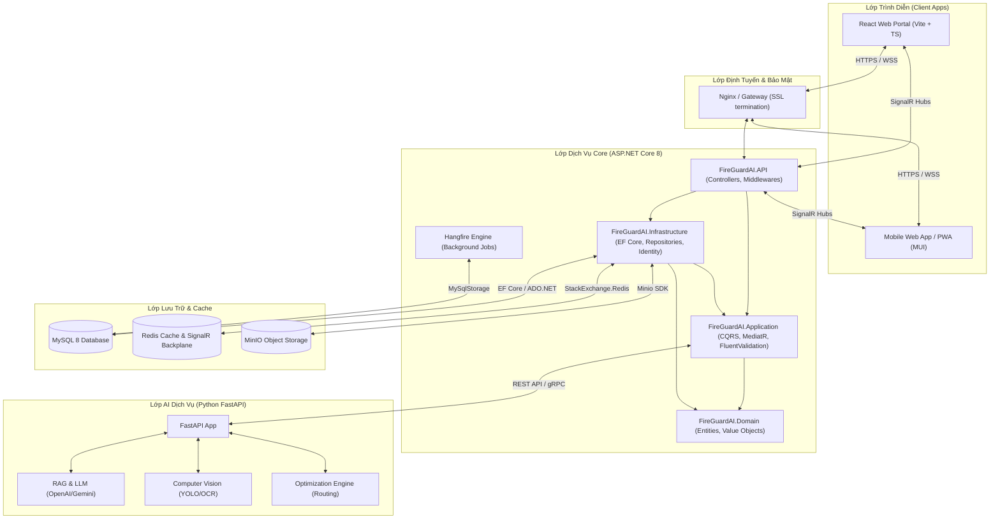

---

## 2. Cấu Trúc Solution Backend (ASP.NET Core 8 Clean Architecture)

Solution được tổ chức thành 4 projects chính tương ứng với 4 lớp của Clean Architecture:

```
FireGuardAI.sln
├── src
│   ├── FireGuardAI.Domain
│   │   ├── Common (BaseEntity, IAuditableEntity, ISoftDelete)
│   │   ├── Entities (User, Role, Permission, Customer, Supplier, Device, DeviceSerial, Project, Task, AuditLog...)
│   │   ├── Exceptions (DomainExceptions)
│   │   └── ValueObjects (GPSLocation, Money)
│   │
│   ├── FireGuardAI.Application
│   │   ├── Common (Interfaces, Behaviors, Exceptions, Models)
│   │   │   ├── Interfaces (IDbContext, ICacheService, IStorageService, IAIService, ICurrentUserService)
│   │   │   └── Behaviours (ValidationBehaviour, LoggingBehaviour, PerformanceBehaviour)
│   │   ├── DTOs (Auth, User, Device, Project, WorkOrder...)
│   │   ├── Features (CQRS Handlers using MediatR)
│   │   │   ├── Authentication (Commands, Queries)
│   │   │   ├── Devices (Commands, Queries, Validators)
│   │   │   └── Projects (Commands, Queries, Validators)
│   │   └── Mappings (AutoMapper Profiles)
│   │
│   ├── FireGuardAI.Infrastructure
│   │   ├── Persistence (ApplicationDbContext, Configurations, Migrations, Seeders)
│   │   ├── Repositories (GenericRepository, UnitOfWork, SpecificRepositories)
│   │   ├── Identity (IdentityService, TokenService)
│   │   ├── Services (RedisCacheService, MinioStorageService, FastAPIClientService)
│   │   └── BackgroundJobs (HangfireJobsManager)
│   │
│   └── FireGuardAI.API
│       ├── Controllers (BaseApiController, AuthController, DeviceController, ProjectController...)
│       ├── Middlewares (GlobalExceptionMiddleware, PerformanceMiddleware, AuditMiddleware)
│       ├── Hubs (NotificationHub, LiveTrackingHub)
│       ├── Extensions (ServiceCollectionExtensions)
│       ├── Program.cs
│       └── appsettings.json
```

---

## 3. Cấu Trúc Thư Mục Frontend (Vite + React + TypeScript)

Sử dụng cấu trúc thư mục dạng **Feature-based** giúp quản lý dễ dàng khi ứng dụng phình to:

```
frontend/
├── public/
├── src/
│   ├── assets/             # Hình ảnh, logo, fonts
│   ├── components/         # Các Component dùng chung toàn app (Buttons, Inputs, Table, Modal)
│   ├── config/             # Cấu hình hệ thống (Axios client, Route definitions)
│   ├── context/            # ThemeContext, UIContext
│   ├── features/           # Các Module nghiệp vụ chính
│   │   ├── auth/           # Login, Register, Profile components & Redux slice
│   │   ├── dashboard/      # Admin/Sales/Tech dashboards
│   │   ├── inventory/      # Quản lý kho, quét mã QR
│   │   ├── projects/       # Quản lý công trình, tiến độ lắp đặt
│   │   └── service-tickets/# Quản lý yêu cầu bảo trì, sửa chữa
│   ├── hooks/              # Custom hooks (useAuth, useSignalR, useGPS)
│   ├── layouts/            # Layouts (AdminLayout, CustomerLayout, AuthLayout)
│   ├── routes/             # Định tuyến (ProtectedRoutes, PublicRoutes)
│   ├── store/              # Cấu hình Redux Toolkit (store, rootReducer)
│   ├── services/           # React Query API integrations (queries, mutations)
│   ├── styles/             # Global CSS, Tailwind/MUI theme configuration
│   ├── utils/              # Helper functions (date formatters, token validators, GPS calculators)
│   ├── App.tsx
│   ├── main.tsx
│   └── vite-env.d.ts
├── index.html
├── tsconfig.json
├── package.json
└── vite.config.ts
```

---

## 4. Cấu Trúc AI Service (Python FastAPI)

```
ai-service/
├── app/
│   ├── core/               # Cấu hình hệ thống (config, security, logger)
│   ├── api/                # Các Router API endpoints
│   │   ├── v1/
│   │   │   ├── chat.py     # API chatbot tư vấn PCCC
│   │   │   ├── vision.py   # API quét bản vẽ, chẩn đoán lỗi qua ảnh
│   │   │   ├── routing.py  # API tối ưu hóa tuyến đường & điều phối
│   │   │   └── kpi.py      # API phân tích KPI nhân sự
│   ├── services/           # Logic xử lý nghiệp vụ AI
│   │   ├── llm_service.py  # Gọi API OpenAI/Gemini + RAG
│   │   ├── cv_service.py   # Xử lý ảnh bằng OpenCV, YOLO
│   │   └── opt_service.py  # Giải bài toán VRP (Vehicle Routing Problem)
│   ├── models/             # Định nghĩa Pydantic Schemas cho API
│   ├── utils/              # Helper functions, RAG VectorDB helpers
│   ├── main.py
│   └── requirements.txt
├── models_weight/          # Lưu trữ trọng số model offline (nếu có)
├── Dockerfile
└── README.md
```

---

## 5. Các Luồng Dữ Liệu Và Quy Trình Kỹ Thuật (Data Workflows)

### 5.1. Luồng Xác Thực JWT & Refresh Token

Đảm bảo bảo mật bằng cách sử dụng **Access Token (lưu ở bộ nhớ tạm - Memory)** và **Refresh Token (được thiết lập HttpOnly Cookie chống tấn công XSS)**.

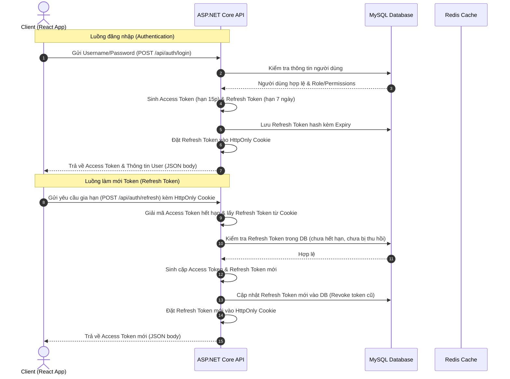

### 5.2. Luồng Realtime SignalR

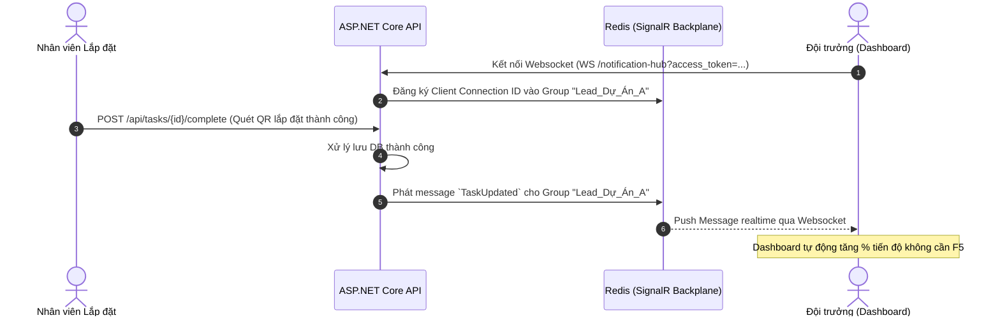

### 5.3. Luồng Upload File (MinIO)

Để tránh tải nặng cho API Server, hệ thống áp dụng cơ chế **Presigned URL**:

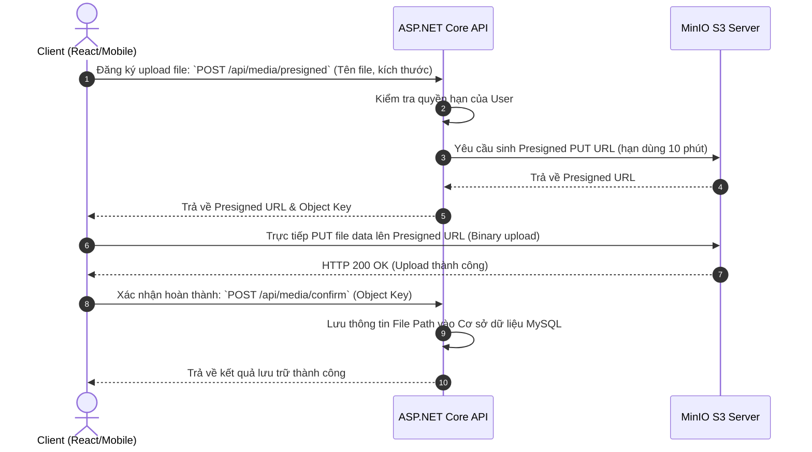

### 5.4. Luồng AI Điều Phối Kỹ Thuật Viên

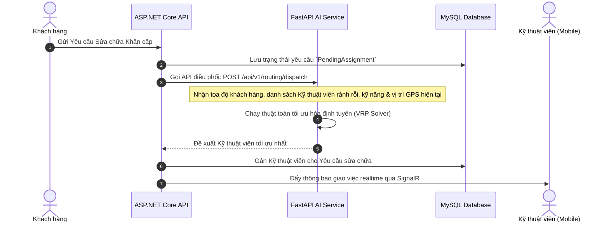

### 5.5. Luồng Background Job Nhắc Nhở Bảo Trì (Hangfire)

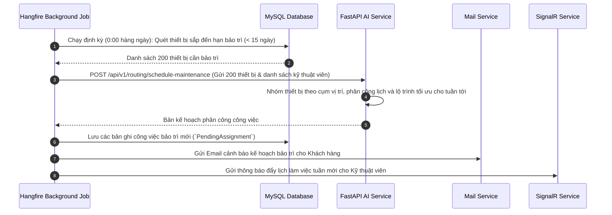

### 5.6. Luồng GPS Check-in & Check-out

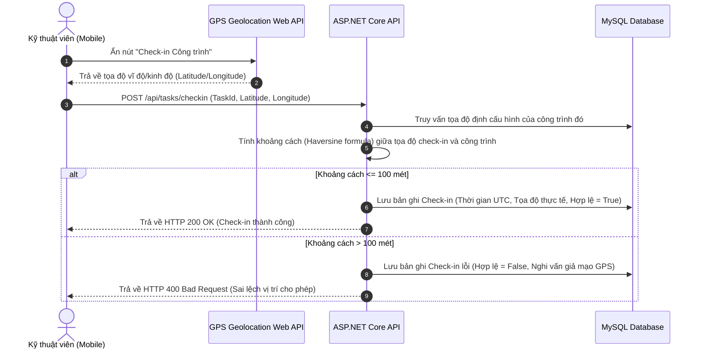

---

## 6. Chiến Lược Giám Sát, Bảo Mật Và Vận Hành (Ops & Security)

### 6.1. Chiến lược Logging (Serilog)
*   **Structured Logging**: Ghi log dưới định dạng cấu trúc JSON giúp dễ dàng truy vấn và phân tích.
*   **Sinks**:
    *   `Console`: Hiển thị log trực tiếp khi phát triển ở local.
    *   `File`: Ghi file log xoay vòng hàng ngày (Daily rolling file) lưu trong thư mục `Logs/` của container, tự động xóa log cũ hơn 30 ngày.
*   **Log Levels**:
    *   *Development*: `Debug` trở lên.
    *   *Production*: `Information` trở lên, chỉ ghi `Warning`/`Error` đối với các lỗi hệ thống để tiết kiệm dung lượng lưu trữ.
*   **Correlation ID**: Mỗi request sẽ được gán một `CorrelationId` duy nhất ở Middleware đầu tiên để theo vết luồng xử lý từ Client qua API tới FastAPI.

### 6.2. Chiến lược Audit Log
*   Tự động ghi lại các thao tác thay đổi dữ liệu (Create, Update, Delete) của các bảng danh mục quan trọng (Thiết bị, Kho, Hợp đồng, Công trình).
*   **Cơ chế**: Triển khai `SaveChangesAsync` tùy biến trong Entity Framework Core. Khi lưu dữ liệu, EF Core sẽ phát hiện các thực thể triển khai interface `IAuditableEntity`, so sánh dữ liệu cũ (Original Values) và dữ liệu mới (Current Values), tự động lưu kết quả vào bảng `AuditLogs`:
    *   `Id` (Khóa chính)
    *   `UserId` (Ai thực hiện thao tác)
    *   `TableName` (Tên bảng bị tác động)
    *   `Action` (INSERT, UPDATE, DELETE)
    *   `OldValues` (JSON chứa trạng thái cũ)
    *   `NewValues` (JSON chứa trạng thái mới)
    *   `Timestamp` (Thời gian thực hiện UTC)

### 6.3. Chiến lược Backup Database (MySQL)
*   **Automated Backups**: Thiết lập một Docker container phụ chạy công cụ `cron` kết hợp `mysqldump` để backup dữ liệu tự động.
*   **Tần suất**:
    *   *Daily Backup*: Chạy vào lúc 2:00 AM hàng ngày. Lưu giữ bản backup trong vòng 30 ngày.
    *   *Weekly/Monthly Backup*: Chạy vào chủ nhật hàng tuần và ngày đầu tháng. Lưu giữ trong vòng 1 năm.
*   **Lưu trữ**: File backup sau khi nén (`.sql.gz`) sẽ được tự động đồng bộ lên một bucket riêng tư trên **MinIO Storage** (được cấu hình chính sách bảo vệ chống xóa).

### 6.4. Biện Pháp Bảo Mật Hệ Thống (Security Hardening)
1.  **Chống tấn công XSS & CSRF**:
    *   Lưu trữ Refresh Token trong `HttpOnly`, `Secure` và `SameSite=Strict` Cookie.
    *   Cấu hình Content Security Policy (CSP) chặt chẽ trên Frontend.
2.  **CORS Policy**: Cấu hình API chỉ cho phép các Domain cụ thể của Frontend truy cập, cấm cấu hình dạng wild-card (`*`) ở môi trường Production.
3.  **Rate Limiting**: Triển khai Rate Limiting Middleware ở lớp API Gateway/Nginx và ASP.NET Core API (ví dụ: tối đa 60 requests/phút trên mỗi IP đối với API thông thường, và 5 requests/phút đối với API Auth/Login).
4.  **SQL Injection Prevention**: Bắt buộc sử dụng Entity Framework Core parameterized queries (LINQ) để tương tác DB, cấm tuyệt đối việc cộng chuỗi SQL sống.
5.  **Dữ liệu nhạy cảm**: Mã hóa mật khẩu người dùng bằng thuật toán băm mạnh `BCrypt` hoặc `PBKDF2` với muối ngẫu nhiên (Salt).
6.  **MinIO Security**: Không public toàn bộ bucket. Tất cả tệp tải lên (ngoại trừ ảnh đại diện người dùng hoặc ảnh thiết bị công cộng) đều nằm trong bucket private và chỉ truy cập được qua Presigned URL có thời gian hết hạn ngắn.

---

## 7. Các Sơ Đồ Thiết Kế & Đặc Tả Hệ Thống (UML & System Diagrams)

### 7.1. Sơ Đồ Phân Rã Chức Năng Nghiệp Vụ (BFD - Business Function Diagram)

Sơ đồ phân rã chức năng mô tả cấu trúc hình cây của các phân hệ nghiệp vụ trong FireGuard AI:

```mermaid
graph TD
    Root["HỆ THỐNG FIREGUARD AI"]

    %% Cấp 1
    F1["1. Quản Trị Hệ Thống"]
    F2["2. Bán Hàng & Báo Giá AI"]
    F3["3. Thi Công & Quản Lý Đội Trưởng"]
    F4["4. Sửa Chữa, Bảo Trì & Điều Phối"]
    F5["5. Quản Lý Kho & Thiết Bị QR"]
    F6["6. Phân Hệ Trí Tuệ Nhân Tạo (AI)"]

    Root --> F1
    Root --> F2
    Root --> F3
    Root --> F4
    Root --> F5
    Root --> F6

    %% Cấp 2 - Phân hệ 1
    F1 --> F11["1.1. Quản lý tài khoản & Phân quyền"]
    F1 --> F12["1.2. Nhật ký kiểm toán (Audit Logs)"]
    F1 --> F13["1.3. Cấu hình tham số hệ thống"]
    F1 --> F14["1.4. Báo cáo & Thống kê doanh thu"]

    %% Cấp 2 - Phân hệ 2
    F2 --> F21["2.1. Quản lý thông tin khách hàng (CRM)"]
    F2 --> F22["2.2. Tư vấn giải pháp PCCC tự động"]
    F2 --> F23["2.3. Lập dự toán & Báo giá sơ bộ AI"]
    F2 --> F24["2.4. Quản lý hợp đồng & Đơn hàng"]

    %% Cấp 2 - Phân hệ 3
    F3 --> F31["3.1. Quản lý danh sách công trình dự án"]
    F3 --> F32["3.2. Phân công tổ thợ nội bộ (Nhân công 1, 2, 3, 4)"]
    F3 --> F33["3.3. Báo cáo tiến độ ngày kèm ảnh chụp hiện trường"]
    F3 --> F34["3.4. Nghiệm thu bàn giao & Kích hoạt bảo hành"]

    %% Cấp 2 - Phân hệ 4
    F4 --> F41["4.1. Tiếp nhận sự cố & Đặt lịch dịch vụ"]
    F4 --> F42["4.2. Điều phối kỹ thuật viên tự động (AI Dispatch)"]
    F4 --> F43["4.3. Bản đồ số & Dẫn đường GPS"]
    F4 --> F44["4.4. Kiểm tra bán kính GPS <= 1km"]
    F4 --> F45["4.5. Chụp ảnh nghiệm thu hiện trường & Hoàn thành đơn"]

    %% Cấp 2 - Phân hệ 5
    F5 --> F51["5.1. Quản lý danh mục thiết bị PCCC"]
    F5 --> F52["5.2. Quản lý tồn kho theo từng kho"]
    F5 --> F53["5.3. Nhập / Xuất kho theo Serial"]
    F5 --> F54["5.4. Khởi tạo & Quét mã QR Code thiết bị"]

    %% Cấp 2 - Phân hệ 6
    F6 --> F61["6.1. Chatbot RAG tư vấn tiêu chuẩn TCVN PCCC"]
    F6 --> F62["6.2. Thuật toán tối ưu hóa điều phối theo GPS"]
    F6 --> F63["6.3. Thị giác máy tính nhận diện hư hỏng thiết bị"]
    F6 --> F64["6.4. Đánh giá xếp hạng KPI kỹ thuật viên"]
```

---

### 7.2. Sơ Đồ Use Case Tổng Thể (Use Case Diagram)

Sơ đồ thể hiện mối quan hệ giữa các tác nhân (Actors) và các ca sử dụng (Use Cases) trong hệ thống:

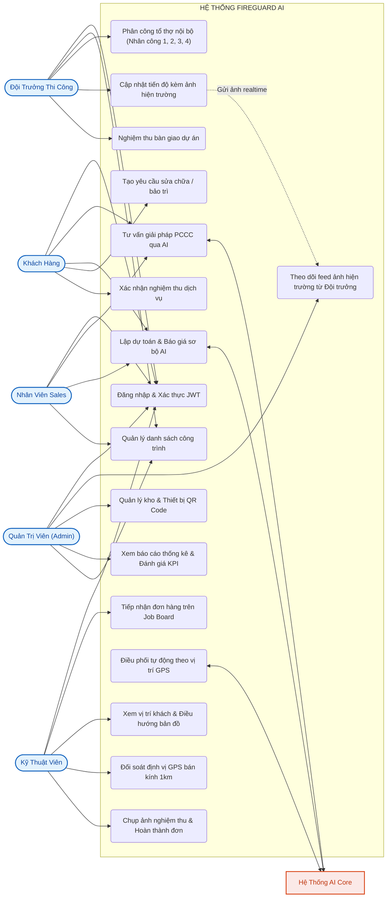

---

### 7.3. Tài Liệu Đặc Tả Use Case Chính (Use Case Specifications)

#### Đặc Tả Use Case 01: Quản Lý Thi Công & Phân Công Tổ Thợ (Đội Trưởng)

| Thuộc Tính | Chi Tiết |
| :--- | :--- |
| **Mã Use Case** | **UC-01** |
| **Tên Use Case** | Quản lý thi công & Phân công tổ thợ nội bộ |
| **Tác nhân chính** | Đội trưởng thi công (`INSTALLATION_LEADER`) |
| **Mô tả** | Cho phép Đội trưởng truy cập không gian công trình, phân bổ trực tiếp các hạng mục công việc cụ thể cho Nhân công 1, 2, 3, 4 mà không cần tạo tài khoản database riêng cho thợ. |
| **Tiền điều kiện** | Đội trưởng đã đăng nhập vào hệ thống và được gán phụ trách công trình. |
| **Hậu điều kiện** | Bảng phân công công việc của các thợ được lưu trữ và cập nhật trạng thái tiến độ tức thời. |
| **Luồng sự kiện chính (Basic Flow)** | 1. Đội trưởng chọn menu **"Thi công & Lắp đặt"** (`/projects/installation`).<br>2. Hệ thống hiển thị danh sách các dự án đang phụ trách kèm % tiến độ.<br>3. Đội trưởng nhấn **"Vào Quản Lý"** của một dự án.<br>4. Hệ thống mở tab **"Phân Công Tổ Thợ"**, hiển thị thẻ công việc của Nhân công 1, 2, 3, 4.<br>5. Đội trưởng nhập nhiệm vụ cụ thể (đấu tủ báo cháy, kéo dây, gắn đầu báo khói...), ghi chú và chọn trạng thái (*Chưa làm / Đang làm / Hoàn thành*).<br>6. Dữ liệu phân bổ được tự động lưu trên bộ nhớ cục bộ dự án của Đội trưởng. |
| **Luồng nhánh / Ngoại lệ** | - Khi tiến độ đạt 100%, nút **"Nghiệm Thu Bàn Giao"** sẽ sáng lên để Đội trưởng kết thúc giai đoạn thi công chuyển sang bảo hành. |

---

#### Đặc Tả Use Case 02: Báo Cáo Tiến Độ Kèm Ảnh Hiện Trường (Đội Trưởng)

| Thuộc Tính | Chi Tiết |
| :--- | :--- |
| **Mã Use Case** | **UC-02** |
| **Tên Use Case** | Báo cáo tiến độ thi công kèm hình ảnh hiện trường thực tế |
| **Tác nhân chính** | Đội trưởng thi công (`INSTALLATION_LEADER`) |
| **Tác nhân phụ** | Quản trị viên (`ADMIN`), Ban Giám đốc (`SALES`) |
| **Mô tả** | Đội trưởng báo cáo % tiến độ và nhật ký công việc trong ngày, kèm hình ảnh chụp thực địa tại công trình truyền trực tiếp về Trang chủ Admin. |
| **Tiền điều kiện** | Đội trưởng đang mở chi tiết dự án thi công. |
| **Hậu điều kiện** | Bản ghi `ProjectProgressLogs` mới được tạo, ảnh hiện trường xuất hiện trên Dashboard Admin. |
| **Luồng sự kiện chính (Basic Flow)** | 1. Đội trưởng nhấn nút **"Báo Cáo Tiến Độ & Ảnh"**.<br>2. Hộp thoại báo cáo mở ra, Đội trưởng kéo thanh trượt % tiến độ hoàn thành (0 - 100%).<br>3. Đội trưởng nhập nhật ký công việc thực tế trong ngày.<br>4. Đội trưởng tải ảnh chụp từ camera điện thoại/máy tính hoặc chọn nhanh ảnh mẫu nghiệp vụ PCCC.<br>5. Hệ thống hiển thị ảnh xem trước (Preview).<br>6. Đội trưởng nhấn **"Gửi Báo Cáo Về Admin"**.<br>7. Hệ thống gọi API `POST /api/project/{id}/progress`, lưu log vào DB và phát tín hiệu SignalR.<br>8. Trang chủ Admin (`/dashboard`) nhận cập nhật và hiển thị ảnh hiện trường trong mục **"📸 Báo Cáo Hiện Trường Từ Đội Trưởng"**. |
| **Luồng ngoại lệ** | - Nếu bỏ trống phần ghi chú: Hệ thống cảnh báo yêu cầu nhập nhật ký trước khi gửi. |

---

#### Đặc Tả Use Case 03: Nghiệm Thu Hoàn Thành Đơn Kèm Ảnh & Đối Soát GPS (Kỹ Thuật Viên)

| Thuộc Tính | Chi Tiết |
| :--- | :--- |
| **Mã Use Case** | **UC-03** |
| **Tên Use Case** | Đối soát định vị GPS bán kính 1km & Chụp ảnh nghiệm thu hoàn thành đơn |
| **Tác nhân chính** | Kỹ thuật viên (`TECHNICIAN`) |
| **Mô tả** | Kỹ thuật viên hoàn tất công việc sửa chữa/bảo trì tại hiện trường, hệ thống kiểm tra khoảng cách GPS (phải trong bán kính 1km) và **bắt buộc tải ảnh nghiệm thu thực tế** mới cho phép hoàn thành đơn. |
| **Tiền điều kiện** | Kỹ thuật viên đã nhận đơn và đang xử lý đơn ở trạng thái `Repairing` hoặc trên bản đồ điều phối. |
| **Hậu điều kiện** | Trạng thái đơn chuyển sang `Completed` (11), ảnh nghiệm thu được lưu vào `ServiceRequestStatusLogs`. |
| **Luồng sự kiện chính (Basic Flow)** | 1. Kỹ thuật viên hoàn tất sửa chữa thiết bị PCCC, nhấn nút **"Đã Hoàn Thành"**.<br>2. Hệ thống thu thập tọa độ GPS hiện tại từ Geolocation API và tính khoảng cách Haversine tới địa chỉ khách hàng.<br>3. **Kiểm tra GPS**: Khoảng cách `<= 1.0 km` -> Cho phép tiếp tục.<br>4. Hệ thống mở hộp thoại **"Nghiệm Thu Hoàn Thành & Tải Ảnh Hiện Trường"**.<br>5. Kỹ thuật viên nhập ghi chú kết quả sửa chữa.<br>6. Kỹ thuật viên **bắt buộc tải ảnh chụp thực tế thiết bị đã khắc phục** (từ camera điện thoại/tệp ảnh).<br>7. Hệ thống hiển thị ảnh xem trước.<br>8. Kỹ thuật viên nhấn **"Xác Nhận Hoàn Thành Đơn"**.<br>9. Hệ thống gửi request `POST /api/service/{id}/status` với `newStatus: 11` và `attachmentUrl`.<br>10. Trạng thái đơn được cập nhật thành công, phát thông báo Realtime tới Admin và Khách hàng. |
| **Luồng ngoại lệ** | - **Cách khách hàng > 1.0 km**: Hệ thống chặn và báo lỗi *"Bạn đang ở cách khách hàng X km. Bắt buộc phải ở trong bán kính 1km mới có thể hoàn thành đơn."*<br>- **Chưa có ảnh nghiệm thu**: Nút *"Xác Nhận Hoàn Thành Đơn"* bị vô hiệu hóa kèm cảnh báo màu vàng bắt buộc phải có ảnh. |

---

### 7.4. Sơ Đồ Luồng Dữ Liệu (DFD - Data Flow Diagram)

#### 7.4.1. Sơ Đồ DFD Mức Ngữ Cảnh (Context Level 0)

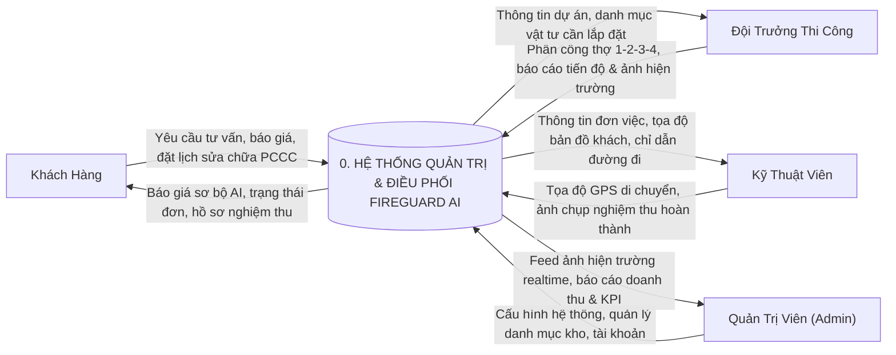

---

### 7.4.2. Sơ Đồ DFD Mức 1 (Data Flow Diagram Level 1)

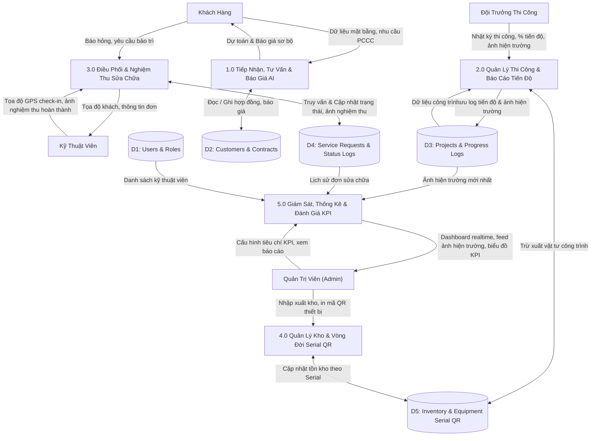

---

### 7.5. Sơ Đồ Thực Thể Liên Kết (ERD - Entity-Relationship Diagram)

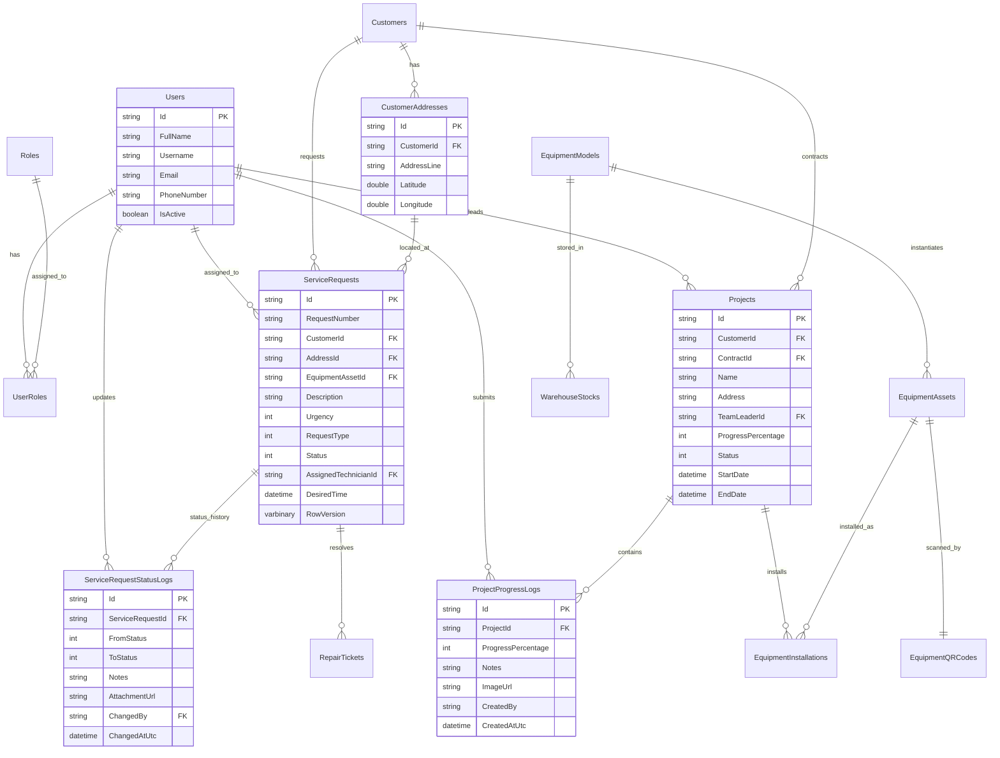

---

### 7.6. Sơ Đồ Lớp (Class Diagram - Domain, Application & API)

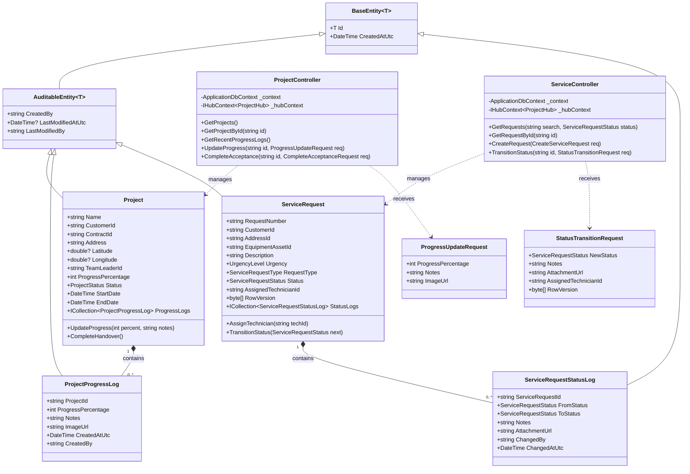

---

### 7.7. Sơ Đồ Hoạt Động (Activity Diagrams - Các Quy Trình Chính)

#### 7.7.1. Hoạt Động 1: Quy Trình Phân Công Thợ & Báo Cáo Ảnh Tiến Độ (Đội Trưởng Thi Công)

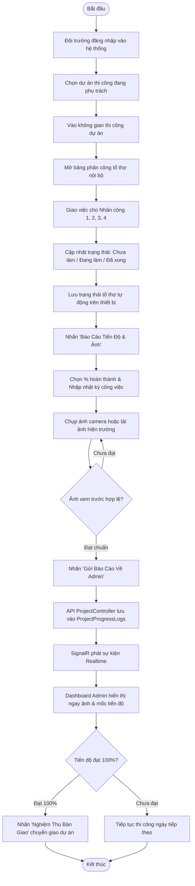

---

#### 7.7.2. Hoạt Động 2: Quy Trình Đối Soát GPS 1km & Nghiệm Thu Kèm Ảnh (Kỹ Thuật Viên)

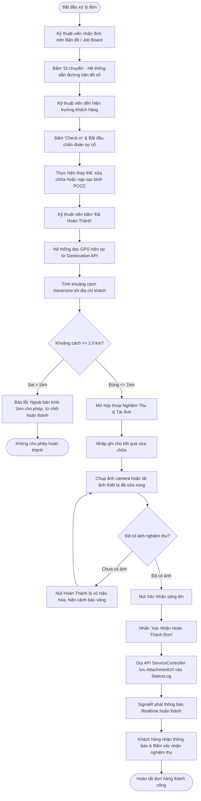

---

#### 7.7.3. Hoạt Động 3: Quy Trình Điều Phối Tự Động Kỹ Thuật Viên Bằng AI (AI Automated Dispatch)

```mermaid
flowchart TD
    Start([Yêu cầu sửa chữa mới]) --> SystemEvent[Khách hàng gửi yêu cầu dịch vụ PCCC]
    SystemEvent --> AIService[Kích hoạt AI Dispatch Engine]
    AIService --> GetTechnicians[Quét danh sách kỹ thuật viên đang Online]
    GetTechnicians --> FilterSkills[Lọc kỹ thuật viên theo chứng chỉ & loại thiết bị]
    FilterSkills --> CalcMatrix[Tính ma trận khoảng cách GPS từ thợ tới khách hàng]
    CalcMatrix --> ScoreKPI[Kết hợp điểm đánh giá sao & chỉ số KPI hoàn thành đơn]
    ScoreKPI --> RankTechs[Sắp xếp danh sách kỹ thuật viên tối ưu nhất]

    RankTechs --> SendOffer[Gửi thông báo nhận việc ưu tiên tới Kỹ thuật viên Top 1]
    SendOffer --> WaitTimer[Bắt đầu đếm ngược thời gian phản hồi (3 phút)]

    WaitTimer --> TechResponse{Kỹ thuật viên phản hồi?}
    TechResponse -- Đồng ý nhận việc --> AssignSuccess[Chuyển trạng thái: Assigned / Đã giao việc]
    TechResponse -- Từ chối hoặc Hết giờ --> PickNext[Chuyển sang Kỹ thuật viên Top 2 tiếp theo]
    PickNext --> SendOffer

    AssignSuccess --> PushJob[Đẩy đơn vào màn hình Bản đồ điều phối của thợ]
    PushJob --> End([Kết thúc quy trình điều phối])
```
